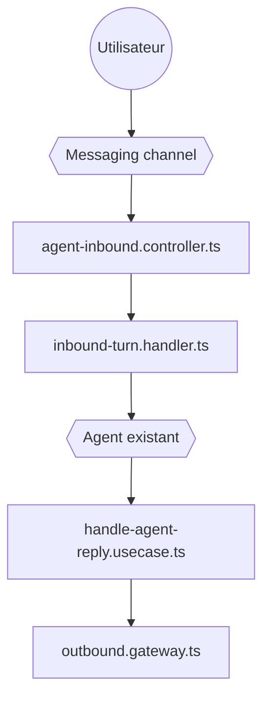

# novuhq/novu

> Infrastructure de notifications multicanal et de conversation entre agents IA et utilisateurs.

## Le problème
Chaque canal (e-mail, SMS, push, Slack, Teams) a son fournisseur et ses webhooks ; les agents doivent y parler sans réécriture.

## Ce que ça fait vraiment
Une API pour envoyer des notifications via des dizaines de fournisseurs, avec workflows, digests, composant Inbox et préférences. Une couche « agents » reçoit les messages d'un canal, les normalise, les route vers ton agent et renvoie sa réponse.

## Comment c'est branché


## Essayer
```bash
npx novu@latest connect
```
Sinon : créer un compte gratuit et suivre le tableau de bord.

## Coût et pièges
Le démarrage passe par un compte cloud ; les fournisseurs (Twilio, SendGrid, etc.) se paient séparément. Licence non identifiée par GitHub : vérifier avant auto-hébergement.

## Ce que ce n'est pas
Pas un agent : Novu transporte les messages. Pas de tarifs précisés dans le README.

## Alternatives
Aucune alternative nommée dans le README.

## Pour toi
À surveiller : utile pour relier un agent IA à Slack ou à l'e-mail, mais dépendance cloud et licence à lire.

