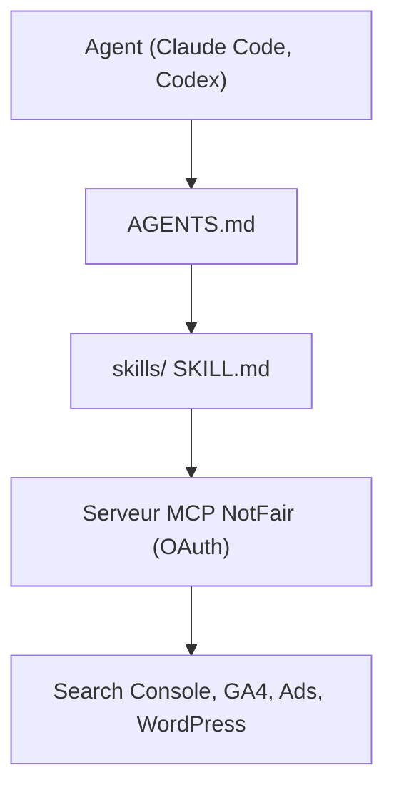

# nowork-studio/notfair-plugin

> Forty-eight SEO, GEO and advertising skills for AI agents, connected to your accounts through an MCP.

## The problem
Auditing a site or ad campaigns with an agent gives generic answers without access to the real data.

## What it actually does
Each skill is a SKILL.md file with a readable WORKFLOW.md, covering SEO, GEO, Google Ads, Meta Ads, X, LinkedIn, Reddit, TikTok, WordPress, GoHighLevel and analytics. Account analyses go through a single NotFair MCP server, connected via OAuth. The plugin installs for Claude Code, Codex, Cursor, Gemini CLI and Kiro. Changes require explicit approval.

## How it is wired
Simplified diagram based on the sheet, no diagram provided.


## Trying it
```bash
/plugin marketplace add nowork-studio/notfair-plugin
/plugin install notfair@nowork-studio
gemini extensions install https://github.com/nowork-studio/notfair-plugin
```

## Cost and gotchas
The skills are free (MIT) but live analysis goes through the hosted NotFair service, with an account and OAuth. Pricing terms are not in the README. Each advertising platform requires its own access.

## What it is not
It is not an autonomous agent: it is a set of procedures. Amazon and ChatGPT Ads remain at the planning stage or limited to reviewing exports.

## Alternatives
No alternative named in the README.

## For you
Keep an eye on it: interesting as a model of well-structured skills, but mostly useful for marketing, and tied to a third-party MCP server.
