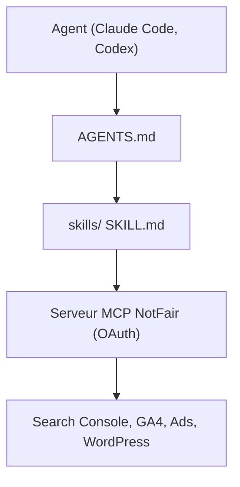

# nowork-studio/notfair-plugin

> Quarante-huit skills SEO, GEO et publicité pour agents IA, connectés à tes comptes via un MCP.

## Le problème
Auditer un site ou des campagnes publicitaires avec un agent donne des réponses génériques sans accès aux vraies données.

## Ce que ça fait vraiment
Chaque skill est un fichier SKILL.md avec un WORKFLOW.md lisible, couvrant SEO, GEO, Google Ads, Meta Ads, X, LinkedIn, Reddit, TikTok, WordPress, GoHighLevel et analytics. Les analyses de comptes passent par un unique serveur MCP NotFair, connecté par OAuth. Le plugin s'installe pour Claude Code, Codex, Cursor, Gemini CLI et Kiro. Les changements demandent une approbation explicite.

## Comment c'est branché
Schéma simplifié d'après la fiche, sans diagramme fourni.


## Essayer
```bash
/plugin marketplace add nowork-studio/notfair-plugin
/plugin install notfair@nowork-studio
gemini extensions install https://github.com/nowork-studio/notfair-plugin
```

## Coût et pièges
Les skills sont libres (MIT) mais l'analyse en direct passe par le service hébergé NotFair, avec compte et OAuth. Les modalités de tarification ne figurent pas dans le README. Chaque plateforme publicitaire exige ses propres accès.

## Ce que ce n'est pas
Ce n'est pas un agent autonome : ce sont des procédures. Amazon et ChatGPT Ads restent en planification ou en revue d'exports.

## Alternatives
Aucune alternative nommée dans le README.

## Pour toi
Surveiller : intéressant comme modèle de skills bien structurés, mais utile surtout au marketing, et lié à un serveur MCP tiers.

