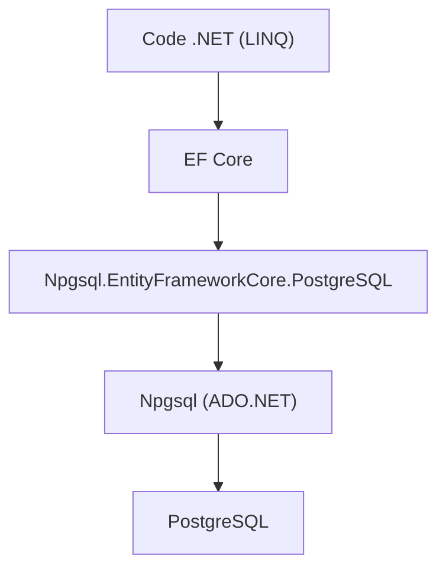

# npgsql/efcore.pg

> EF Core provider for PostgreSQL, aimed at .NET developers who use LINQ.

## The problem
EF Core cannot talk to PostgreSQL without a suitable driver, and PostgreSQL-specific types (JSON, arrays, ranges) remain out of LINQ's reach.

## What it actually does
It plugs the EF Core ORM into PostgreSQL on top of Npgsql. LINQ queries are translated to SQL. It also exposes PostgreSQL-specific features: JSON columns, arrays and ranges. Separate plugins cover PostGIS and NodaTime.

## How it is wired
Simplified diagram based on the sheet, no diagram provided.



## Trying it
```csharp
await using var ctx = new BlogContext();
await ctx.Database.EnsureCreatedAsync();
ctx.Blogs.Add(new() { Name = "FooBlog" });
await ctx.SaveChangesAsync();
// dans OnConfiguring : optionsBuilder.UseNpgsql("Host=myserver;...")
```

## Cost and gotchas
Free, but you need an accessible PostgreSQL server. The README documents no installation command, only a code example.

## What it is not
It is not a data or AI tool: it is plumbing for .NET applications. It does not replace Npgsql, it builds on it.

## Alternatives
No alternative named in the README.

## For you
Ignore for a data / AI / MLOps profile, unless your application stack is .NET: the driver only concerns that ecosystem.
