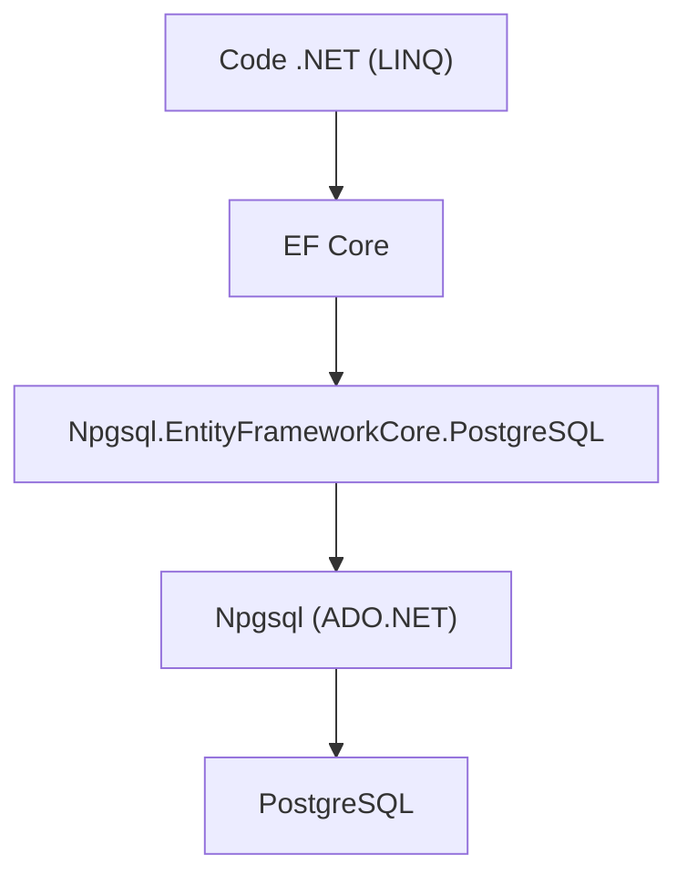

# npgsql/efcore.pg

> Fournisseur EF Core pour PostgreSQL, destiné aux développeurs .NET qui utilisent LINQ.

## Le problème
EF Core ne parle pas à PostgreSQL sans pilote adapté, et les types propres à PostgreSQL (JSON, tableaux, plages) restent hors de portée de LINQ.

## Ce que ça fait vraiment
Il branche l'ORM EF Core sur PostgreSQL au-dessus de Npgsql. Les requêtes LINQ sont traduites en SQL. Il expose aussi des fonctions propres à PostgreSQL : colonnes JSON, tableaux et plages. Des plugins séparés couvrent PostGIS et NodaTime.

## Comment c'est branché
Schéma simplifié d'après la fiche, sans diagramme fourni.



## Essayer
```csharp
await using var ctx = new BlogContext();
await ctx.Database.EnsureCreatedAsync();
ctx.Blogs.Add(new() { Name = "FooBlog" });
await ctx.SaveChangesAsync();
// dans OnConfiguring : optionsBuilder.UseNpgsql("Host=myserver;...")
```

## Coût et pièges
Gratuit, mais il faut un serveur PostgreSQL accessible. Le README ne documente aucune commande d'installation, seulement un exemple de code.

## Ce que ce n'est pas
Ce n'est pas un outil de données ou d'IA : c'est de la plomberie pour applications .NET. Il ne remplace pas Npgsql, il s'appuie dessus.

## Alternatives
Aucune alternative nommée dans le README.

## Pour toi
À ignorer pour un profil data / IA / MLOps, sauf si ta pile applicative est en .NET : le pilote ne concerne que cet écosystème.

