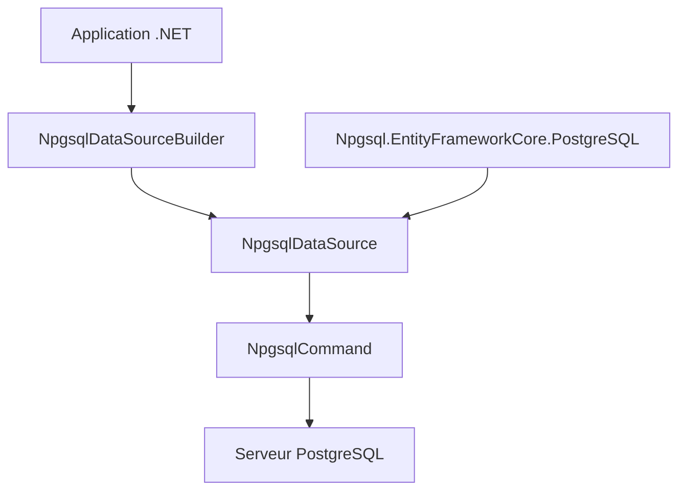

# npgsql/npgsql

> Open-source .NET data driver for PostgreSQL, for C# developers.

## The problem
A .NET application needs a complete, fast PostgreSQL client that is compatible with its advanced types.

## What it actually does
Connects .NET code to PostgreSQL via `NpgsqlDataSource` and commands. Handles advanced types (arrays, enums, ranges, composites, JSON, PostGIS), bulk import and export, failover and multi-host load balancing. The Entity Framework Core provider is a separate repository.

## How it is wired
Simplified diagram based on the sheet, no diagram provided.



## Trying it
```csharp
using Npgsql;
var connString = "Host=myserver;Username=mylogin;Password=mypass;Database=mydatabase";
var dataSourceBuilder = new NpgsqlDataSourceBuilder(connString);
var dataSource = dataSourceBuilder.Build();
var conn = await dataSource.OpenConnectionAsync();
```
No installation command is documented here; see the npgsql.org site.

## Cost and gotchas
Free. You need an accessible PostgreSQL server and credentials. The README details neither the installation nor the minimum .NET version.

## What it is not
Not an ORM: for that, you need the separate EF Core provider. Only serves the .NET ecosystem.

## Alternatives
- Npgsql.EntityFrameworkCore.PostgreSQL: to be used for Entity Framework Core.

## For you
Ignore unless you write .NET on PostgreSQL: a good driver, but outside your usual Python tooling.
