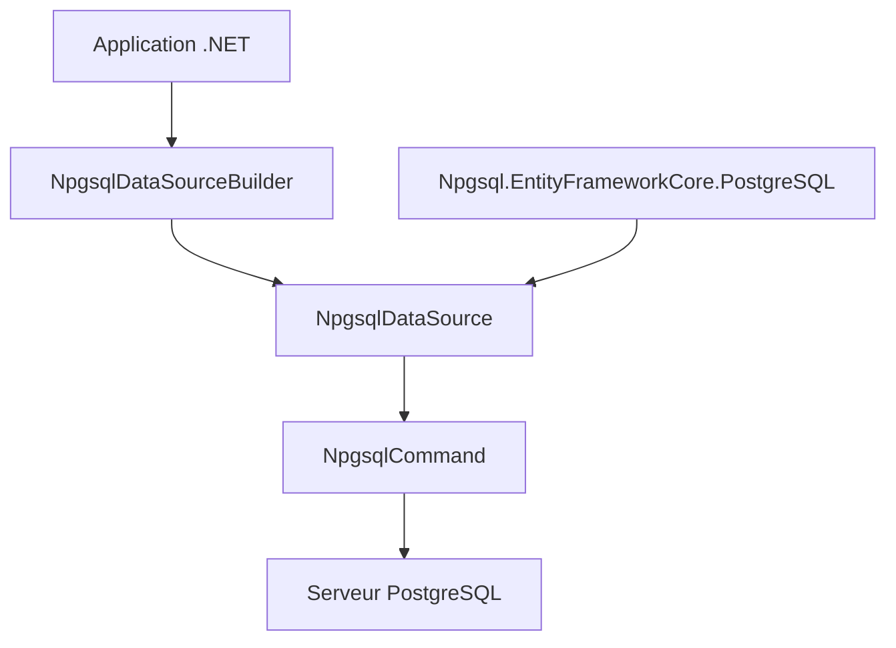

# npgsql/npgsql

> Pilote de données .NET open source pour PostgreSQL, pour développeurs C#.

## Le problème
Une application .NET a besoin d'un client PostgreSQL complet et rapide, compatible avec ses types avancés.

## Ce que ça fait vraiment
Connecte du code .NET à PostgreSQL via `NpgsqlDataSource` et des commandes. Gère les types avancés (tableaux, énumérations, plages, composites, JSON, PostGIS), l'import et l'export en masse, le basculement et la répartition de charge multi-hôtes. Le fournisseur Entity Framework Core est un dépôt séparé.

## Comment c'est branché
Schéma simplifié d'après la fiche, sans diagramme fourni.



## Essayer
```csharp
using Npgsql;
var connString = "Host=myserver;Username=mylogin;Password=mypass;Database=mydatabase";
var dataSourceBuilder = new NpgsqlDataSourceBuilder(connString);
var dataSource = dataSourceBuilder.Build();
var conn = await dataSource.OpenConnectionAsync();
```
Aucune commande d'installation n'est documentée ici ; voir le site npgsql.org.

## Coût et pièges
Gratuit. Il faut un serveur PostgreSQL accessible et des identifiants. Le README ne détaille ni l'installation ni la version minimale de .NET.

## Ce que ce n'est pas
Pas un ORM : pour cela, il faut le fournisseur EF Core séparé. Ne sert qu'à l'écosystème .NET.

## Alternatives
- Npgsql.EntityFrameworkCore.PostgreSQL : à utiliser pour Entity Framework Core.

## Pour toi
À ignorer sauf si tu écris du .NET sur PostgreSQL : bon pilote, mais hors de ton outillage Python habituel.

