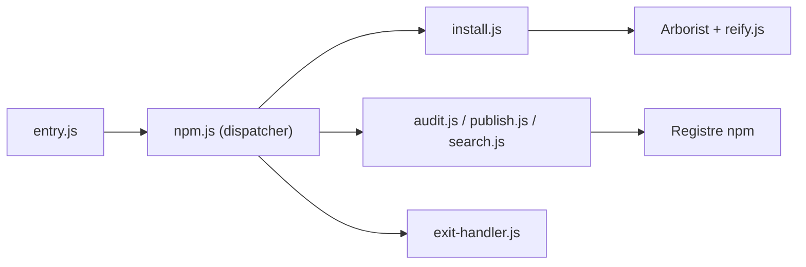

# npm/cli

> JavaScript package manager, shipped with Node.js, to install, publish and audit packages.

## The problem
Managing JavaScript dependencies and their versions, and publishing or auditing packages by hand, is impossible at scale.

## What it actually does
The CLI dispatches each command, resolves the dependency tree (Arborist), writes it to disk (reify), and talks to the default registry `registry.npmjs.org` (configurable). It covers `install`, `search`, `publish`, `query`, `audit`, `exec`, `config`, `version` and authentication.

## How it is wired


## Trying it
```bash
curl -qL https://www.npmjs.com/install.sh | sh
npm <command>
```

## Cost and gotchas
Free. The public registry is subject to terms of use. The license is present but not identified by GitHub: check before redistributing.

## What it is not
Not a manager for Python or ML environments. The README says nothing about its exact license.

## Alternatives
No alternative named in the README.

## For you
Ignore as a watch topic: it comes with Node and adds nothing for a data/AI profile, unless you publish JavaScript packages.
