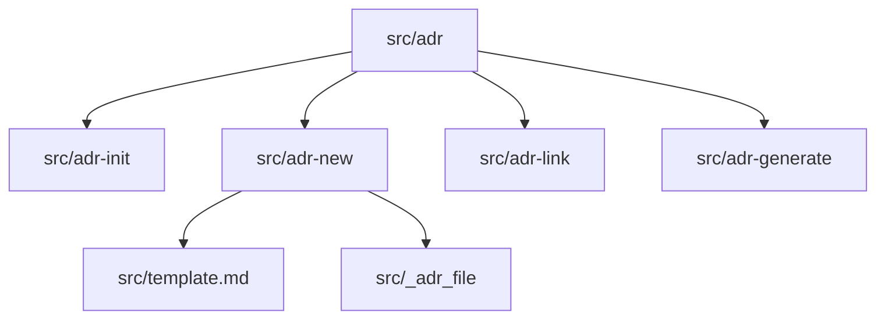

# npryce/adr-tools

> Command-line tool for keeping a log of architecture decisions (ADRs) in Markdown.

## The problem
Architecture decisions get lost in discussions and nobody knows why a choice was made.

## What it actually does
The `adr` command delegates to shell scripts: `adr-init` creates the folder and the first ADR, `adr-new` creates a numbered ADR from a template and opens it in the editor, `adr-link` links ADRs together, and `adr-generate` produces outputs. The `-s` option supersedes a previous ADR.

## How it is wired


## Trying it
```bash
adr init doc/architecture/decisions
adr new Implement as Unix shell scripts
adr new -s 9 Use Rust for performance-critical functionality
adr help
```

## Cost and gotchas
Free, shell scripts. Installation is not detailed in the excerpt. Last push April 2024, 70 open issues. License not identified by GitHub.

## What it is not
Not a modeling tool. Not a general documentation manager: ADRs only.

## Alternatives
No alternative named in the README.

## For you
Keep an eye on it: handy for documenting the choices of an MLOps platform in the repo, but not very active and with an unclear license.
