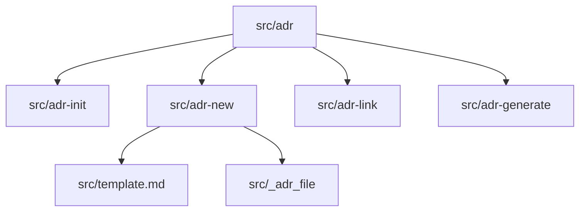

# npryce/adr-tools

> Outil en ligne de commande pour tenir un journal de décisions d'architecture (ADR) en Markdown.

## Le problème
Les décisions d'architecture se perdent dans les discussions et personne ne sait pourquoi un choix a été fait.

## Ce que ça fait vraiment
La commande `adr` délègue à des scripts shell : `adr-init` crée le dossier et le premier ADR, `adr-new` crée un ADR numéroté à partir d'un modèle et l'ouvre dans l'éditeur, `adr-link` relie les ADR et `adr-generate` produit des sorties. Option `-s` pour remplacer un ADR précédent.

## Comment c'est branché


## Essayer
```bash
adr init doc/architecture/decisions
adr new Implement as Unix shell scripts
adr new -s 9 Use Rust for performance-critical functionality
adr help
```

## Coût et pièges
Gratuit, scripts shell. L'installation n'est pas détaillée dans l'extrait. Dernier push avril 2024, 70 issues ouvertes. Licence non identifiée par GitHub.

## Ce que ce n'est pas
Pas un outil de modélisation. Pas un gestionnaire de documentation général : seulement les ADR.

## Alternatives
Aucune alternative nommée dans le README.

## Pour toi
Surveiller : pratique pour documenter les choix d'une plateforme MLOps dans le dépôt, mais peu actif et sans licence claire.

