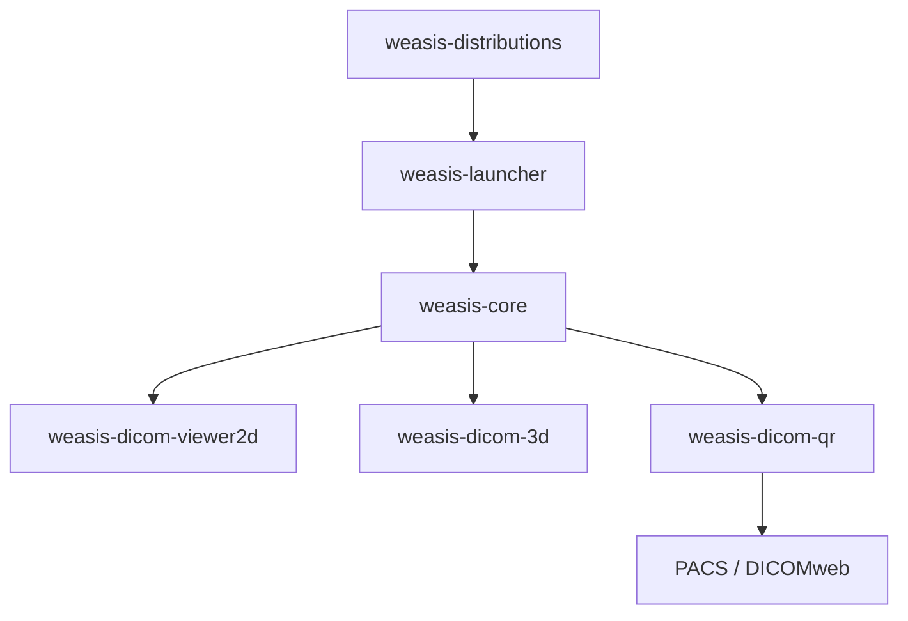

# nroduit/Weasis

> Open-source DICOM viewer, standalone or web, connected to PACS and DICOMweb.

## The problem
Reading and measuring medical images of several modalities, integrated with hospital systems, requires specialized tools.

## What it actually does
Modular Java (OSGi) viewer: multiple DICOM formats, MPR and CPR reconstructions, 3D rendering, PET/CT fusion, SEG segmentation, measurements, SR, ECG, RT. Connectivity via DIMSE, DICOMweb, WADO-URI, the weasis:// protocol, OAuth 2.0 and OpenID Connect. A Dicomizer module converts images and videos to DICOM.

## How it is wired

## Trying it
No command documented in the README: it points to the binaries, the online demo and the build guide.

## Cost and gotchas
Free. The README states EPL 2 or Apache 2, but GitHub does not identify the license: to be checked. Clinical use: regulatory responsibility is yours.

## What it is not
Not a certified medical device according to the README, not a PACS: it reads and displays.

## Alternatives
No alternative named in the README; ViewerHub is cited as a server gateway.

## For you
Watch: a reference for medical imaging, useful if you prepare or inspect DICOM datasets for an AI project.
