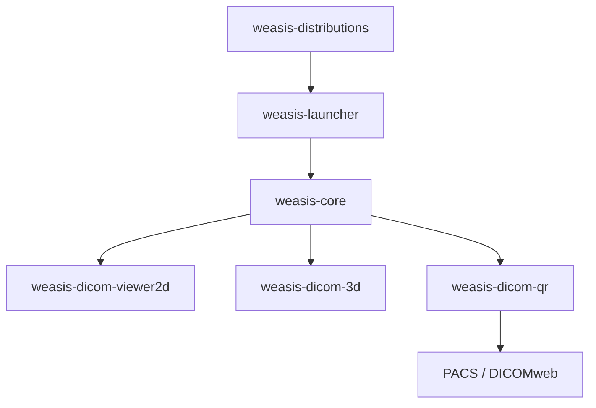

# nroduit/Weasis

> Visionneuse DICOM open source, autonome ou web, branchée sur PACS et DICOMweb.

## Le problème
Lire et mesurer des images médicales de plusieurs modalités, intégrées aux systèmes hospitaliers, demande des outils spécialisés.

## Ce que ça fait vraiment
Visionneuse Java modulaire (OSGi) : formats DICOM multiples, reconstructions MPR et CPR, rendu 3D, fusion PET/CT, segmentation SEG, mesures, SR, ECG, RT. Connectivité DIMSE, DICOMweb, WADO-URI, protocole weasis://, OAuth 2.0 et OpenID Connect. Un module Dicomizer convertit images et vidéos en DICOM.

## Comment c'est branché

## Essayer
Aucune commande documentée dans le README : il renvoie vers les binaires, la démo en ligne et le guide de compilation.

## Coût et pièges
Gratuit. Le README annonce EPL 2 ou Apache 2, mais GitHub n'identifie pas la licence : à vérifier. Usage clinique : responsabilité réglementaire à ta charge.

## Ce que ce n'est pas
Pas un dispositif médical certifié selon le README, pas un PACS : il lit et affiche.

## Alternatives
Aucune alternative nommée dans le README ; ViewerHub est cité comme passerelle serveur.

## Pour toi
Surveiller : référence pour l'imagerie médicale, utile si tu prépares ou inspectes des jeux DICOM pour un projet d'IA.

