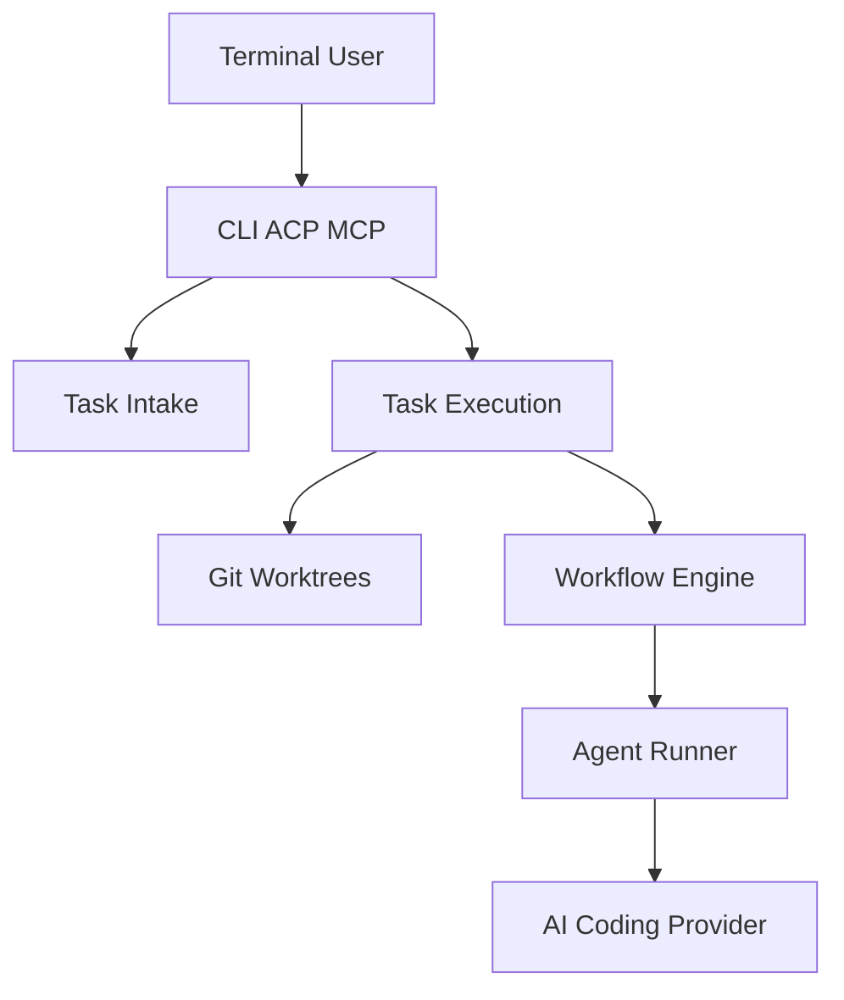

# nrslib/takt

> CLI that enforces a YAML plan, code, review, fix workflow on AI coding agents.

## The problem
An agent left to its own devices forgets instructions, skips the review and mixes implementation with critique.

## What it actually does
You describe a task, it is queued, then `takt run` executes it in an isolated worktree. Each step of the YAML has its own persona, permissions and transition rules. Providers: Claude, Codex, OpenCode, Pi, Cursor, Copilot, Kiro. Logs and reports per step.

## How it is wired


## Trying it
```bash
npm install -g takt
takt install claude-sdk
takt
takt run
takt list
```

## Cost and gotchas
Node 22.22+ and Git 2.38+. Agent calls are billed by the chosen provider; manager mode launches tasks on its own and consumes tokens. Check each provider's OAuth terms of use.

## What it is not
Not an agent: it drives other agents. The manager, the web interface and the director are described as experimental.

## Alternatives
The README compares it to agents used alone (prompt, `CLAUDE.md`, skills), without naming any other orchestrator.

## For you
Worth watching: useful for framing coding agents on ML repos, but the tool is young (created in January 2026) and changes fast.
