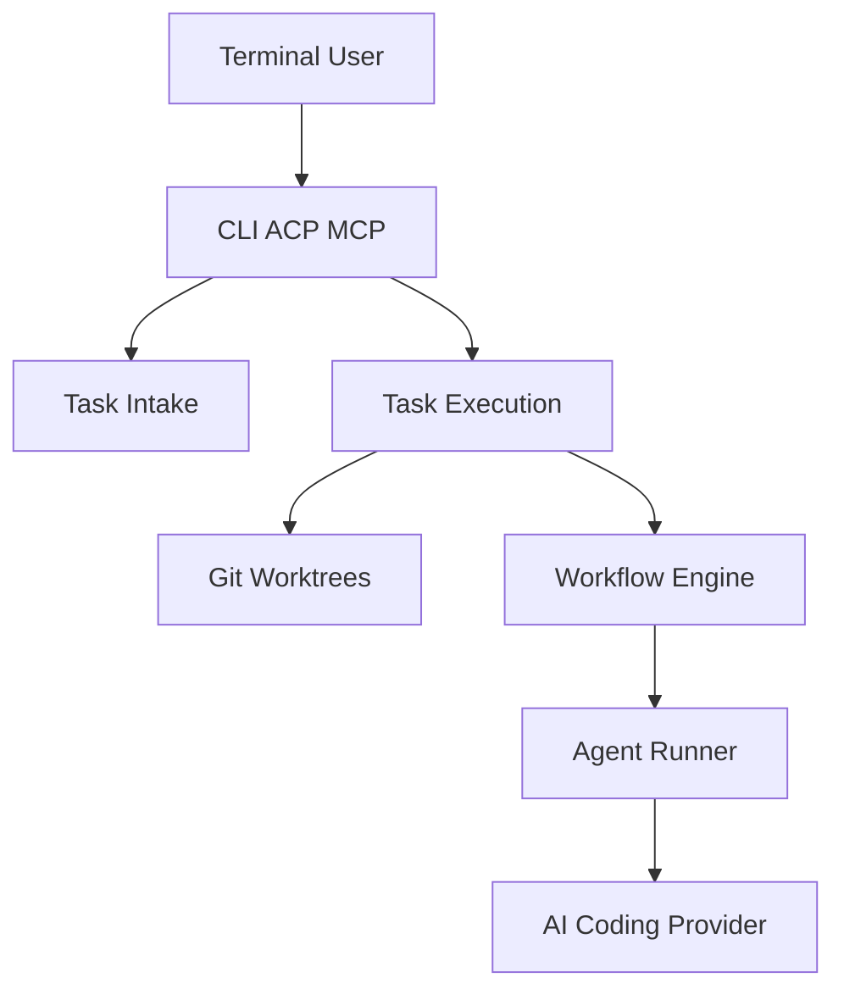

# nrslib/takt

> CLI qui impose un workflow YAML plan, code, revue, correction à des agents de code IA.

## Le problème
Un agent livré à lui-même oublie des consignes, saute la revue et mélange implémentation et critique.

## Ce que ça fait vraiment
Tu décris une tâche, elle est mise en file, puis `takt run` l'exécute dans un worktree isolé. Chaque étape du YAML a sa persona, ses permissions et ses règles de transition. Fournisseurs : Claude, Codex, OpenCode, Pi, Cursor, Copilot, Kiro. Logs et rapports par étape.

## Comment c'est branché


## Essayer
```bash
npm install -g takt
takt install claude-sdk
takt
takt run
takt list
```

## Coût et pièges
Node 22.22+ et Git 2.38+. Les appels aux agents sont facturés par le fournisseur choisi ; le mode manager lance des tâches seul et consomme des jetons. Vérifier les conditions d'usage OAuth de chaque fournisseur.

## Ce que ce n'est pas
Pas un agent : il pilote d'autres agents. Le manager, l'interface web et le director sont décrits comme expérimentaux.

## Alternatives
Le README compare à des agents seuls (prompt, `CLAUDE.md`, skills), sans nommer d'autre orchestrateur.

## Pour toi
À surveiller : intéressant pour cadrer des agents de code sur des dépôts ML, mais l'outil est jeune (créé en janvier 2026) et change vite.

