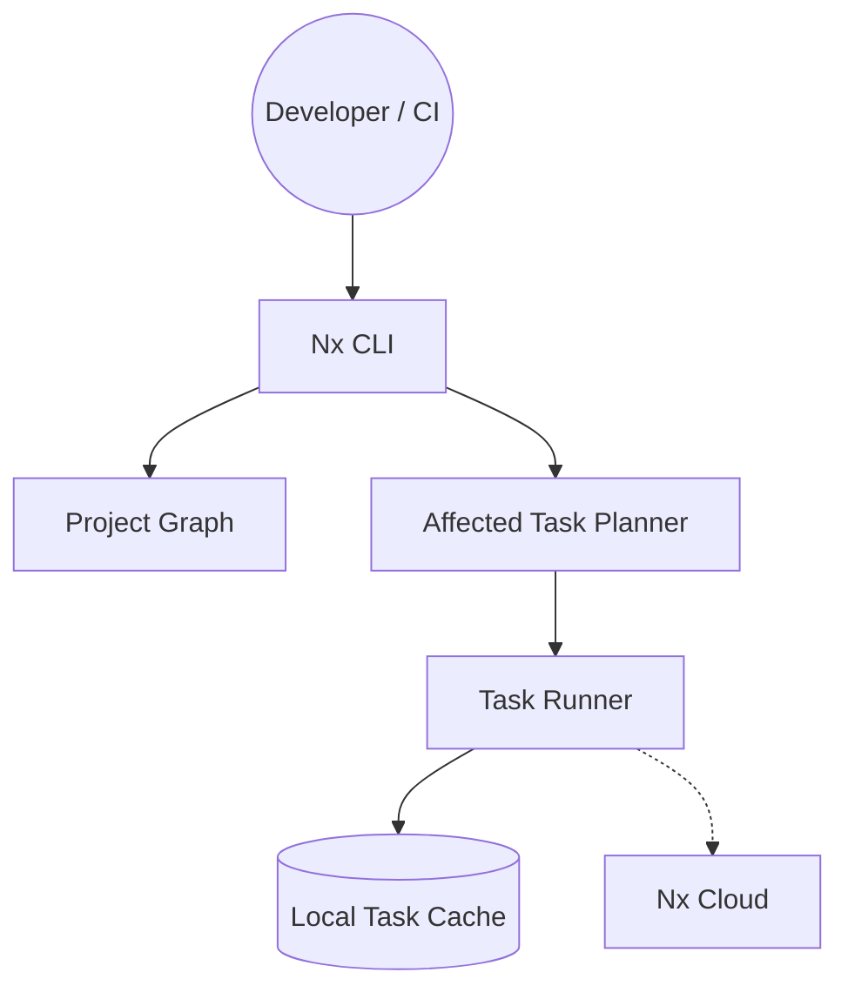

# nrwl/nx

> Monorepo system that caches tasks and runs only what changes affect.

## The problem
In a monorepo, rebuilding and retesting everything on each commit lengthens CI runs.

## What it actually does
Nx builds a project graph, computes the affected tasks, runs them via plugins (Vite, Jest, Gradle, Maven, .NET, Go) and reuses a local or remote cache. It offers integrated CI (remote cache, task distribution) and a "self-healing" CI driven by an AI agent connected over MCP.

Core in Rust, extensions in TypeScript. The CLI plugs into an existing npm, pnpm or yarn workspace by reading the `package.json` scripts. A TUI and a web graph of projects and tasks are provided.

## How it is wired


## Trying it
```bash
npx nx init
```

## Cost and gotchas
Free core; the remote cache and CI belong to Nx Cloud, a third-party service. The local cache works without an account.

## What it is not
Not a data/AI tool. The AI features and integrated CI depend on the hosted offering.

## Alternatives
None named in the README.

## For you
To keep an eye on: useful if your MLOps repository mixes several services and packages, otherwise it is needless complexity.
