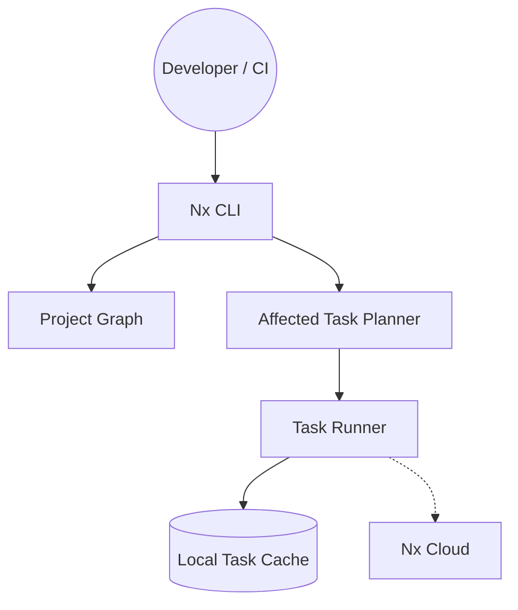

# nrwl/nx

> Système de monorepo qui met en cache les tâches et n'exécute que ce que les changements affectent.

## Le problème
Dans un monorepo, tout reconstruire et retester à chaque commit allonge les CI.

## Ce que ça fait vraiment
Nx construit un graphe de projets, calcule les tâches affectées, les exécute via des plugins (Vite, Jest, Gradle, Maven, .NET, Go) et réutilise un cache local ou distant. Il propose une CI intégrée (cache distant, distribution des tâches) et une CI « auto-réparatrice » par agent IA reliée en MCP.

Cœur en Rust, extensions en TypeScript. Le CLI s'intègre à un espace de travail npm, pnpm ou yarn existant en lisant les scripts de `package.json`. Une interface TUI et un graphe web de projets et de tâches sont fournis.

## Comment c'est branché


## Essayer
```bash
npx nx init
```

## Coût et pièges
Cœur gratuit ; le cache distant et la CI relèvent de Nx Cloud, service tiers. Le cache local fonctionne sans compte.

## Ce que ce n'est pas
Pas un outil data/IA. Les fonctions IA et la CI intégrée dépendent de l'offre hébergée.

## Alternatives
Aucune nommée dans le README.

## Pour toi
À surveiller : utile si ton dépôt MLOps mêle plusieurs services et paquets, sinon c'est une complexité inutile.

