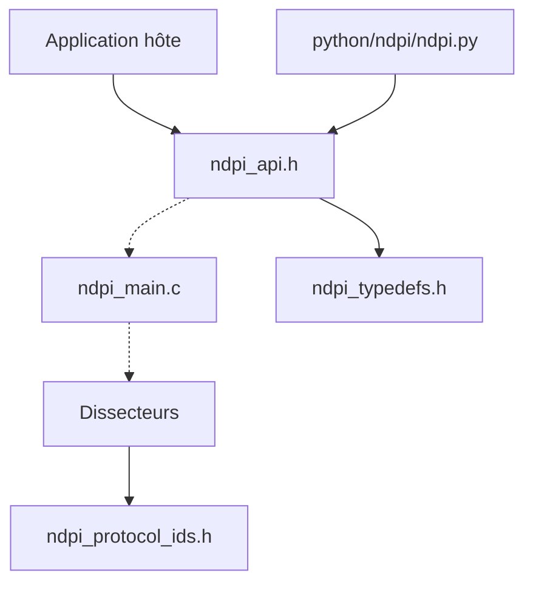

# ntop/nDPI

> Open-source packet inspection library that identifies protocols and applications in network traffic.

## The problem
Knowing which applications or protocols run on a network, including in encrypted traffic.

## What it actually does
The host application supplies packets and flow state, and nDPI returns the detected protocol. Per-protocol dissectors (TLS, HTTP, QUIC, etc.) live in `src/lib/protocols`. The library also offers classification, data analysis and serialization, and a Python wrapper. Some dissectors are dual-licensed. The README explains how to add a protocol.

## How it is wired


## Trying it
```bash
./autogen.sh && ./configure
make
make check
./autogen.sh && ./configure --with-only-libndpi
```

## Cost and gotchas
Free. GNU tools, gcc or Clang and several development libraries. On Windows, npcap in WinPcap-compatible mode. The README warns to respect privacy and to have authorization to inspect the traffic.

## What it is not
Not a monitoring application: it is a library to integrate (ntopng and nProbe use it). Accuracy is not guaranteed at 100%.

## Alternatives
The README mentions nfstream and nDPId as related projects.

## For you
Worth watching: interesting for classifying network traffic with nfstream, good to know for anomaly detection, but far from everyday MLOps work.
