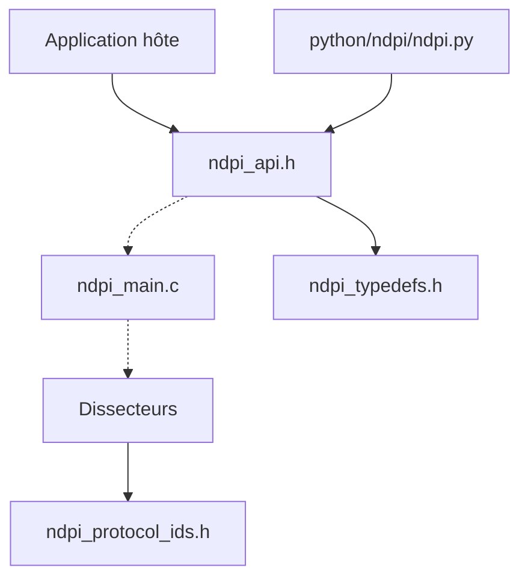

# ntop/nDPI

> Bibliothèque libre d'inspection de paquets qui identifie les protocoles et applications dans le trafic réseau.

## Le problème
Savoir quelles applications ou quels protocoles circulent sur un réseau, y compris en trafic chiffré.

## Ce que ça fait vraiment
L'application hôte fournit paquets et état de flux, nDPI renvoie le protocole détecté. Des dissecteurs par protocole (TLS, HTTP, QUIC, etc.) sont dans `src/lib/protocols`. La bibliothèque propose aussi classification, analyse de données et sérialisation, et un wrapper Python. Certains dissecteurs ont une double licence. Le README explique comment ajouter un protocole.

## Comment c'est branché


## Essayer
```bash
./autogen.sh && ./configure
make
make check
./autogen.sh && ./configure --with-only-libndpi
```

## Coût et pièges
Gratuit. Outils GNU, gcc ou Clang et plusieurs bibliothèques de développement. Sous Windows, npcap en mode compatible WinPcap. Le README prévient de respecter la vie privée et d'avoir l'autorisation d'inspecter le trafic.

## Ce que ce n'est pas
Pas une application de supervision : c'est une bibliothèque à intégrer (ntopng, nProbe l'utilisent). Précision non garantie à 100 %.

## Alternatives
Le README cite nfstream et nDPId comme projets liés.

## Pour toi
Surveiller : intéressant pour classifier du trafic réseau avec nfstream, utile à connaître en détection d'anomalies, mais éloigné d'un travail MLOps courant.

