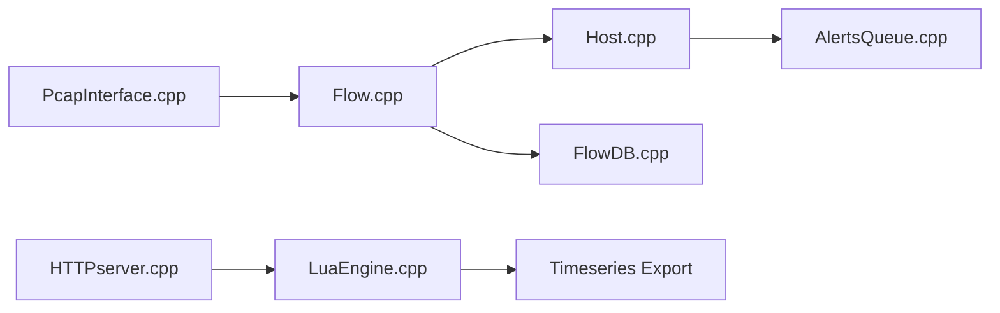

# ntop/ntopng

> Web application for network traffic monitoring, for network administrators.

## The problem
Understanding who consumes bandwidth and detecting abnormal behavior on a network.

## What it actually does
Traffic capture (PCAP, ZMQ, sFlow), flow and host analysis, risk and alert checks, then dashboards, reports and exported time series (RRD, InfluxDB). Also supports syslog and SNMP, with optional Redis and ElasticSearch integrations. Descendant of ntop (1998).

## How it is wired

## Trying it
No documented command: the README points to `doc/README.md` and to the packages from packages.ntop.org (Debian/Ubuntu, CentOS, Windows, FreeBSD, Raspberry Pi).

## Cost and gotchas
Free under GPLv3; trademark registered in the United States and the EU. Details of paid versions are not in the README.

## What it is not
Not a general-purpose data analysis tool: it monitors network flows.

## Alternatives
- No alternative named in the README.

## For you
Ignore: network monitoring, outside the data/AI scope, unless you operate infrastructure yourself.
