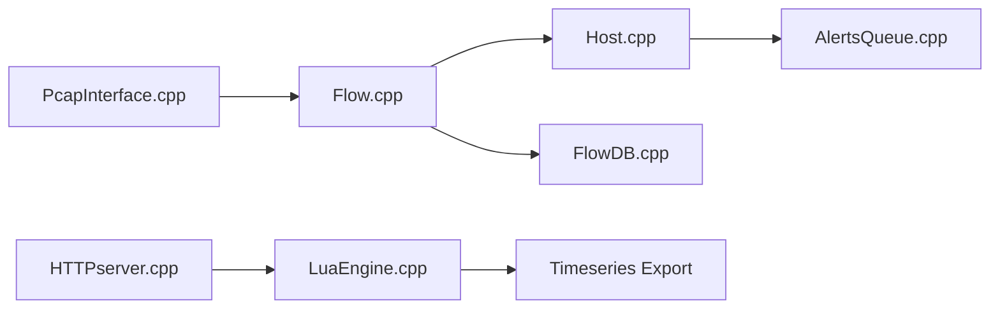

# ntop/ntopng

> Application web de supervision du trafic réseau, pour administrateurs réseau.

## Le problème
Comprendre qui consomme la bande passante et détecter des comportements anormaux sur un réseau.

## Ce que ça fait vraiment
Capture du trafic (PCAP, ZMQ, sFlow), analyse en flux et en hôtes, vérifications de risques et d'alertes, puis tableaux de bord, rapports et séries temporelles exportées (RRD, InfluxDB). Prend aussi en charge syslog et SNMP, avec des intégrations Redis et ElasticSearch optionnelles. Descendant d'ntop (1998).

## Comment c'est branché

## Essayer
Aucune commande documentée : le README renvoie à `doc/README.md` et aux paquets de packages.ntop.org (Debian/Ubuntu, CentOS, Windows, FreeBSD, Raspberry Pi).

## Coût et pièges
Gratuit sous GPLv3 ; marque déposée aux États-Unis et dans l'UE. Les détails de versions payantes ne sont pas dans le README.

## Ce que ce n'est pas
Pas un outil d'analyse de données généraliste : il surveille des flux réseau.

## Alternatives
- Aucune alternative nommée dans le README.

## Pour toi
À ignorer : supervision réseau, hors périmètre data/IA, sauf si tu opères toi-même une infrastructure.

