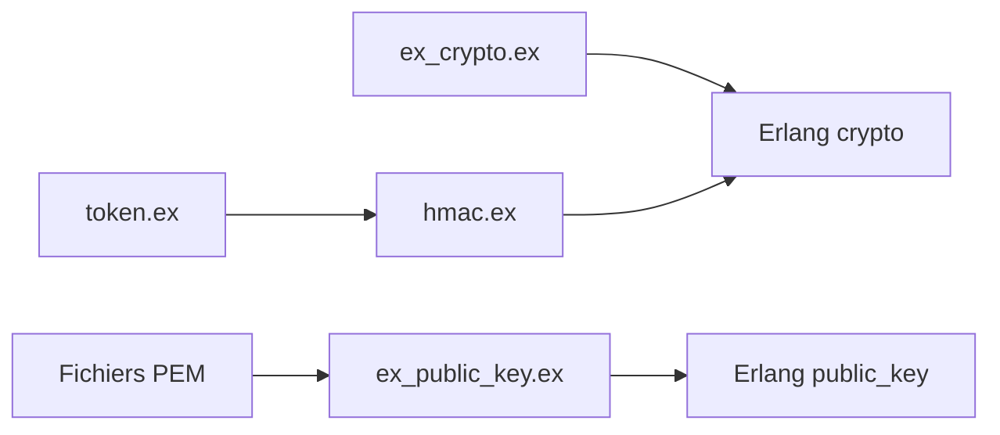

# ntrepid8/ex_crypto

> Elixir wrapper around the Erlang crypto and public_key modules, with simple defaults.

## The problem
Erlang's crypto APIs are verbose; sensible defaults are needed for AES, RSA, HMAC and tokens.

## What it actually does
`ExCrypto`: AES key generation, SHA hashing, HMAC, expiring signed tokens. `ExPublicKey`: PEM key loading, signing, verification, RSA encryption and decryption. The "transmit a shared secret" example is marked "in progress".

## How it is wired


## Trying it
```elixir
{:ok, aes_128_key} = ExCrypto.generate_aes_key(:aes_128, :base64)
{:ok, signature} = ExPublicKey.sign(message, rsa_private_key)
```

## Cost and gotchas
Last push in June 2024, single maintainer. No security audit mentioned.

## What it is not
Not an audited library. The README's tone on key sizes is more joke than advice.

## Alternatives
No alternative named in the README.

## For you
Ignore: unaudited Elixir crypto, outside your data/AI stack.
