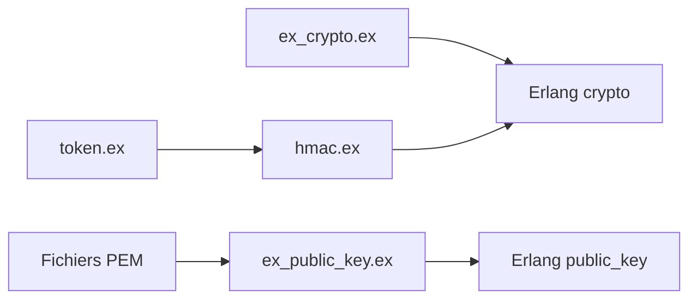

# ntrepid8/ex_crypto

> Enveloppe Elixir des modules Erlang crypto et public_key, avec des valeurs par défaut simples.

## Le problème
Les API crypto d'Erlang sont verbeuses ; il faut des défauts raisonnables pour AES, RSA, HMAC et jetons.

## Ce que ça fait vraiment
`ExCrypto` : génération de clés AES, hachage SHA, HMAC, jetons signés expirants. `ExPublicKey` : chargement de clés PEM, signature, vérification, chiffrement et déchiffrement RSA. L'exemple « transmettre un secret partagé » est marqué « in progress ».

## Comment c'est branché


## Essayer
```elixir
{:ok, aes_128_key} = ExCrypto.generate_aes_key(:aes_128, :base64)
{:ok, signature} = ExPublicKey.sign(message, rsa_private_key)
```

## Coût et pièges
Dernier push en juin 2024, mainteneur unique. Pas d'audit de sécurité mentionné.

## Ce que ce n'est pas
Pas une bibliothèque auditée. Le ton du README sur les tailles de clés est plus plaisanterie que conseil.

## Alternatives
Aucune alternative nommée dans le README.

## Pour toi
À ignorer : crypto Elixir non auditée, hors de ta stack data/IA.

