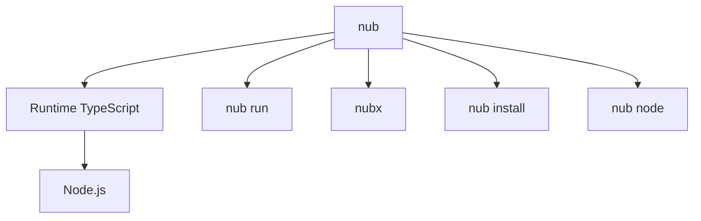

# nubjs/nub

> Node.js toolbox in Rust: runs TypeScript, scripts, installs packages, manages versions.

## The problem
A Node project stitches together tsx, npm, npx, nvm and corepack, each slow to start and to configure.

## What it actually does
A single binary replaces these tools: `nub file.ts` (TypeScript, JSX, `.env` loading, polyfills), `nub run`, `nubx`, `nub install` (pnpm-compatible, blocks postinstall and checks osv.dev by default), `nub watch`, `nub pm` and `nub node` to provision versions. The announced speed gains come from README benchmarks, measured on macOS.

## How it is wired
Simplified diagram based on the sheet, no diagram provided.



## Trying it
```sh
curl -fsSL https://nubjs.com/install.sh | bash
npm install -g @nubjs/nub
nub index.ts
nub run dev
nub install
```

## Cost and gotchas
Free. Repository created in June 2026: young. It installs Node automatically according to `.node-version` or `.nvmrc`, and the install script is piped into bash.

## What it is not
Not a new runtime: it wraps the standard `node`. The speed figures come from the authors, not from an independent measurement.

## Alternatives
- Bun: cited as a comparison for installation.
- Deno: whose features it borrows.
- pnpm: compatibility reference.

## For you
Keep an eye on it: useful if you write Node tooling or AI front-ends, but too young to replace your current toolchain without testing.
