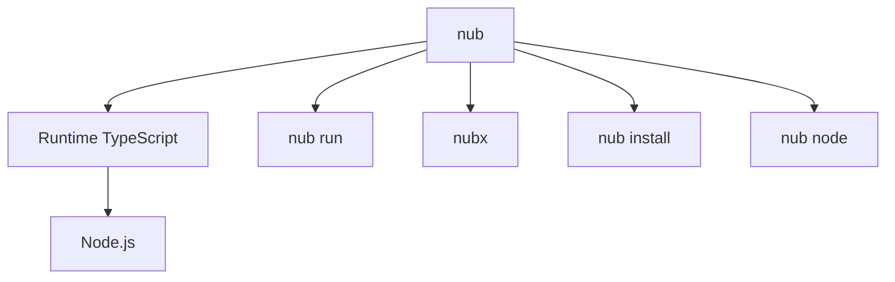

# nubjs/nub

> Boîte à outils Node.js en Rust : exécute TypeScript, scripts, installe les paquets, gère les versions.

## Le problème
Un projet Node assemble tsx, npm, npx, nvm et corepack, chacun lent à démarrer et à configurer.

## Ce que ça fait vraiment
Un binaire unique remplace ces outils : `nub fichier.ts` (TypeScript, JSX, chargement `.env`, polyfills), `nub run`, `nubx`, `nub install` (compatible pnpm, bloque postinstall et vérifie osv.dev par défaut), `nub watch`, `nub pm` et `nub node` pour provisionner les versions. Les gains de vitesse annoncés viennent de benchmarks du README, mesurés sur macOS.

## Comment c'est branché
Schéma simplifié d'après la fiche, sans diagramme fourni.



## Essayer
```sh
curl -fsSL https://nubjs.com/install.sh | bash
npm install -g @nubjs/nub
nub index.ts
nub run dev
nub install
```

## Coût et pièges
Gratuit. Dépôt créé en juin 2026 : jeune. Il installe Node automatiquement selon `.node-version` ou `.nvmrc`, et le script d'installation se pipe dans bash.

## Ce que ce n'est pas
Pas un nouveau runtime : il enveloppe le `node` standard. Les chiffres de vitesse viennent des auteurs, pas d'une mesure indépendante.

## Alternatives
- Bun : cité comme comparaison pour l'installation.
- Deno : dont il reprend des fonctions.
- pnpm : référence de compatibilité.

## Pour toi
À surveiller : utile si tu écris des outils Node ou des front-ends d'IA, mais trop jeune pour remplacer ton chaîne actuelle sans test.

