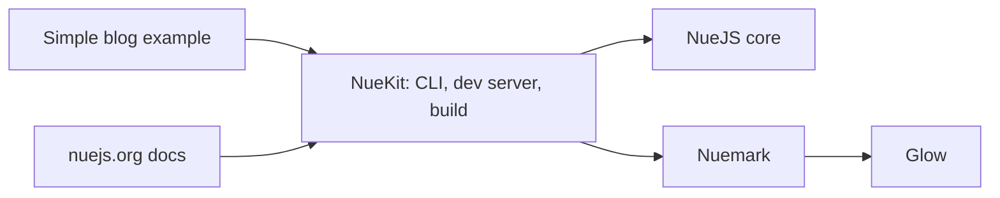

# nuejs/nue

> Monorepo of a web framework (NueKit); the README provided only gives the path to another README.

## The problem
Not documented in the README read: it contains only the line `packages/nuekit/README.md`.

## What it actually does
Minimal sheet, for lack of material. According to the architecture described from the code: a monorepo with `nuekit` (build tool, development server, hot reload, view transitions), `nuejs` (components, templates, browser runtime), `nuemark` (Markdown engine) and `glow` (syntax highlighting), plus a docs site and a blog example. This description is generated and unverified.

## How it is wired

## Trying it
No command documented in the README read.

## Cost and gotchas
Not documented. The runtime prerequisite is not indicated in the material provided.

## What it is not
It is not assessed here: without a usable README, no promise of the project could be verified.

## Alternatives
No alternative named in the README.

## For you
Ignore: insufficient material to decide, and a web framework does not fit data/AI/MLOps work; reread the `packages/nuekit` README before any judgment.
