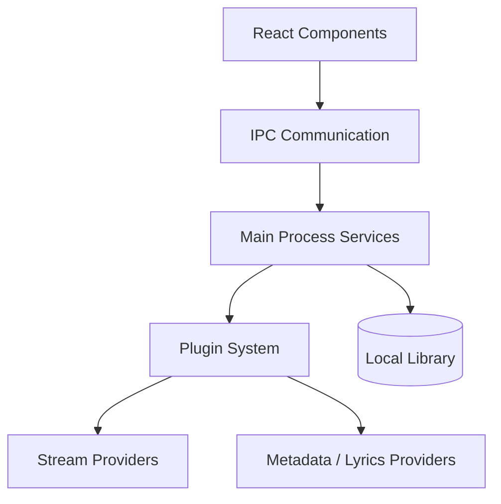

# nukeop/nuclear

> Free desktop music player, with no ads or tracking, extensible through plugins and controllable via MCP.

## The problem
Streaming services impose accounts, ads and tracking, and lock in the music library.

## What it actually does
Tauri application (Rust and React) that searches for tracks and plays them through source plugins. It manages artists, albums, favorites, playlists, synced lyrics, history and themes. An optional MCP server (port 8800) lets an agent control the player. A plugin store is built in.

## How it is wired

The provided diagram describes the old Electron version.

## Trying it
```bash
claude mcp add nuclear --transport http http://127.0.0.1:8800/mcp
git clone https://github.com/nukeop/nuclear.git
cd nuclear
pnpm install
pnpm dev
```

## Cost and gotchas
Free. Node 22, pnpm and Rust are needed to build. Streaming sources depend on third-party plugins whose legality depends on their content.

## What it is not
Not a streaming service: it does not provide a catalog itself. The provided diagram (Electron, Redux) is obsolete. AGPL-3.0 license: sharing obligations in case of a network derivative.

## Alternatives
No alternative named in the README.

## For you
Ignore for your line of work: a consumer music player, only the local MCP server example is instructive.
