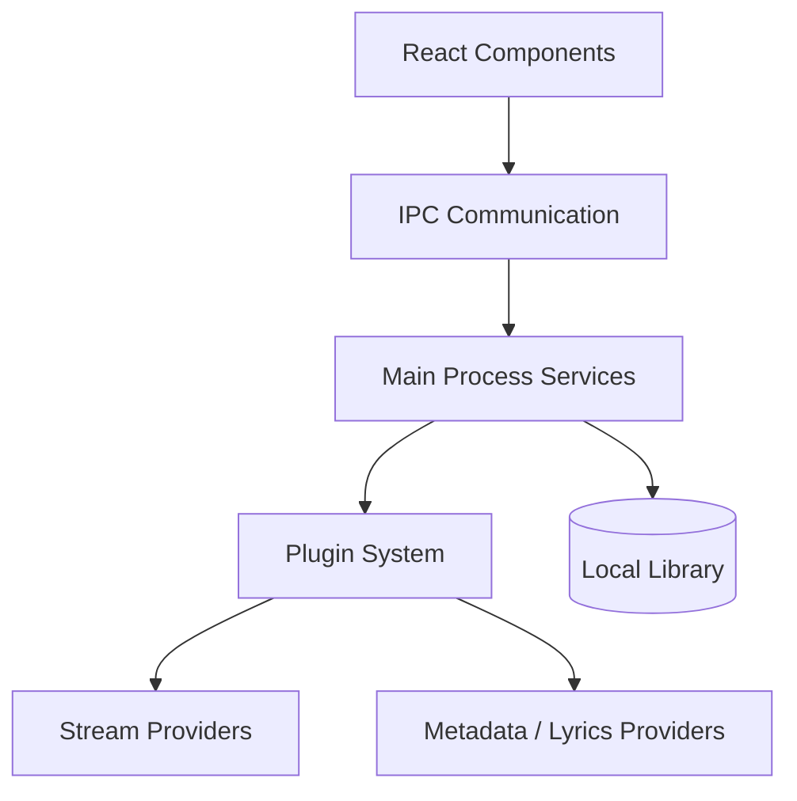

# nukeop/nuclear

> Lecteur de musique de bureau libre, sans pub ni pistage, extensible par plugins et pilotable en MCP.

## Le problème
Les services de streaming imposent comptes, publicités et suivi, et enferment la bibliothèque musicale.

## Ce que ça fait vraiment
Application Tauri (Rust et React) qui cherche des morceaux et les lit via des plugins de sources. Elle gère artistes, albums, favoris, playlists, paroles synchronisées, historique et thèmes. Un serveur MCP optionnel (port 8800) laisse un agent piloter le lecteur. Un magasin de plugins est intégré.

## Comment c'est branché

Le diagramme fourni décrit l'ancienne version Electron.

## Essayer
```bash
claude mcp add nuclear --transport http http://127.0.0.1:8800/mcp
git clone https://github.com/nukeop/nuclear.git
cd nuclear
pnpm install
pnpm dev
```

## Coût et pièges
Gratuit. Node 22, pnpm et Rust pour compiler. Les sources de streaming dépendent de plugins tiers dont la légalité dépend de leur contenu.

## Ce que ce n'est pas
Pas un service de streaming : il ne fournit pas de catalogue lui-même. Le diagramme fourni (Electron, Redux) est obsolète. Licence AGPL-3.0 : obligations de partage en cas de dérivé réseau.

## Alternatives
Aucune alternative nommée dans le README.

## Pour toi
À ignorer pour ton métier : lecteur de musique grand public, seul l'exemple de serveur MCP local est instructif.

