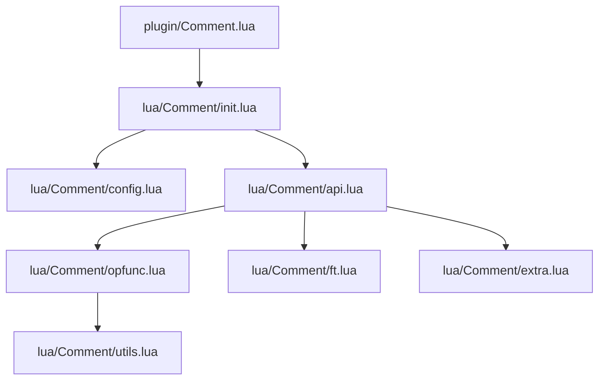

# numToStr/Comment.nvim

> Neovim plugin that comments and uncomments lines or blocks with a shortcut, for people who edit code in Neovim.

## The problem
Commenting each line of a selection by hand is slow, and the comment string changes depending on the language and on files mixing several languages.

## What it actually does
After `setup()`, it creates shortcuts (`gcc`, `gbc`, `gc{motion}`, `gco`, `gcO`, `gcA`) that toggle the comment in line or block form. The comment string comes from `commentstring`, from Treesitter or from `ft.lua`. It handles counts, dot repeat, before/after hooks and a Lua pattern to skip lines. JSX/TSX is not handled natively.

## How it is wired
Diagram based on the provided graph.



## Trying it
```lua
-- lazy.nvim
{
    'numToStr/Comment.nvim',
    opts = {
        -- add any options here
    }
}
-- puis, selon le gestionnaire :
require('Comment').setup()
```

## Cost and gotchas
Free, no key. Last push in August 2024 and 87 open issues: little upkeep. For JSX/TSX you must add nvim-ts-context-commentstring through `pre_hook`.

## What it is not
Not a refactoring or code documentation tool. It only works in Neovim, and the `ignore` option applies only to line comments.

## Alternatives
- tcomment: the ancestor that motivated the plugin.
- nvim-comment: a smaller and less complete version.
- kommentary: well made according to the README, but with fewer features.

## For you
Worth watching: useful if you code in Neovim, but the last push is more than a year old and a single maintainer carries it, so check recent alternatives before adopting it.
