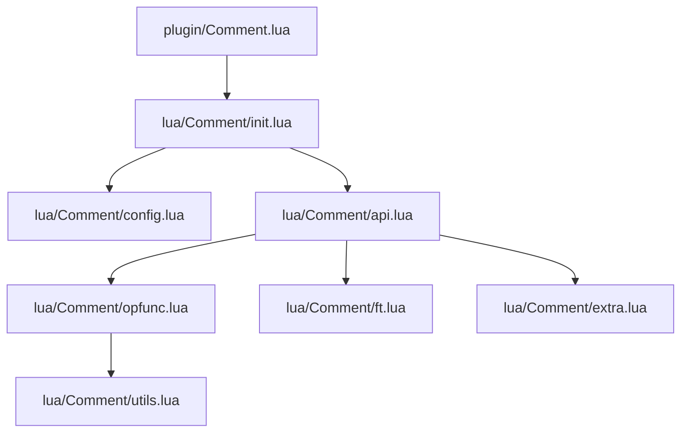

# numToStr/Comment.nvim

> Plugin Neovim qui commente et décommente lignes ou blocs d'un raccourci, pour qui édite du code dans Neovim.

## Le problème
Commenter à la main chaque ligne d'une sélection est lent, et la chaîne de commentaire change selon le langage et les fichiers à langages imbriqués.

## Ce que ça fait vraiment
Après `setup()`, il crée des raccourcis (`gcc`, `gbc`, `gc{motion}`, `gco`, `gcO`, `gcA`) qui basculent le commentaire en ligne ou en bloc. La chaîne de commentaire vient de `commentstring`, de Treesitter ou de `ft.lua`. Il gère le comptage, la répétition par point, des hooks avant/après et un motif Lua pour ignorer des lignes. JSX/TSX n'est pas géré nativement.

## Comment c'est branché
Schéma d'après le diagramme fourni.



## Essayer
```lua
-- lazy.nvim
{
    'numToStr/Comment.nvim',
    opts = {
        -- add any options here
    }
}
-- puis, selon le gestionnaire :
require('Comment').setup()
```

## Coût et pièges
Gratuit, aucune clé. Dernier push en août 2024 et 87 issues ouvertes : peu de suivi. Pour JSX/TSX il faut ajouter nvim-ts-context-commentstring via `pre_hook`.

## Ce que ce n'est pas
Pas un outil de refactoring ni de documentation de code. Il ne fonctionne que dans Neovim, et l'option `ignore` ne vaut que pour les commentaires en ligne.

## Alternatives
- tcomment : l'ancêtre qui a motivé le plugin.
- nvim-comment : version plus petite et moins complète.
- kommentary : bien fait selon le README, mais moins riche en fonctions.

## Pour toi
À surveiller : utile si tu codes dans Neovim, mais le dernier push date de plus d'un an et un mainteneur unique le porte, donc vérifie les alternatives récentes avant de l'adopter.

