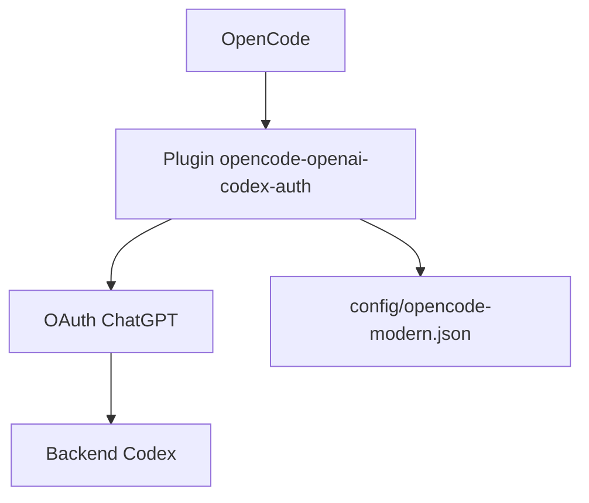

# numman-ali/opencode-openai-codex-auth

> An OpenCode plugin that gives access to GPT-5.x and Codex models through a ChatGPT subscription.

## The problem
Using Codex models in OpenCode normally requires going through the pay-per-use API.

## What it actually does
An npx installer that configures OpenCode with ChatGPT Plus or Pro OAuth authentication, 22 model presets (GPT-5.2, GPT-5.2 Codex, GPT-5.1) and their reasoning levels. It handles token renewal and usage-quota errors. A modern and a legacy configuration are provided for OpenCode versions.

## How it is wired


## Trying it
```bash
npx -y opencode-openai-codex-auth@latest
opencode auth login
opencode run "write hello world to test.txt" --model=openai/gpt-5.2 --variant=medium
npx -y opencode-openai-codex-auth@latest --uninstall
```

## Cost and gotchas
A ChatGPT Plus or Pro subscription is required. Last push in January 2026 and dependence on an OAuth flow that may change on OpenAI's side.

## What it is not
Not built for production or multi-user use: the README asks for the OpenAI Platform API in that case. Minimal configurations are not supported.

## Alternatives
No alternative named in the README.

## For you
Worth watching: handy if you already have a ChatGPT subscription and use OpenCode, but dependent on an access not designed for large-scale use.
