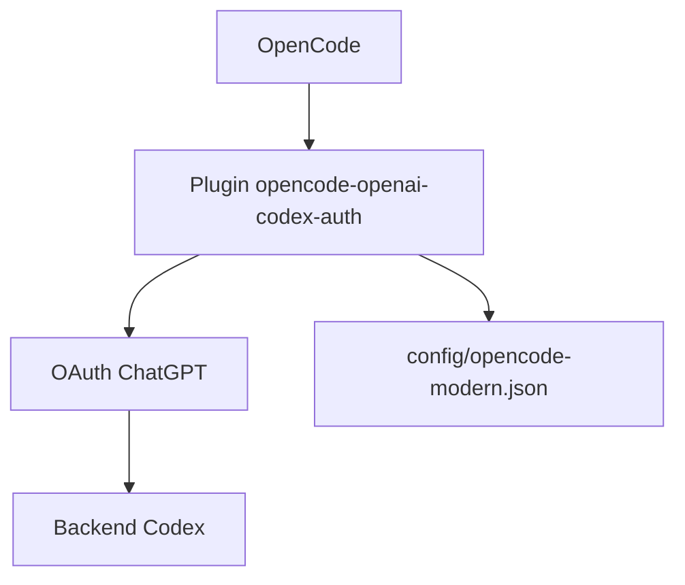

# numman-ali/opencode-openai-codex-auth

> Un plugin OpenCode qui donne accès aux modèles GPT-5.x et Codex via un abonnement ChatGPT.

## Le problème
Utiliser les modèles Codex dans OpenCode oblige normalement à passer par l'API facturée à l'usage.

## Ce que ça fait vraiment
Un installateur npx qui configure OpenCode avec une authentification OAuth ChatGPT Plus ou Pro, 22 préréglages de modèles (GPT-5.2, GPT-5.2 Codex, GPT-5.1) et leurs niveaux de raisonnement. Il gère le renouvellement des jetons et des erreurs liées au quota d'usage. Une configuration moderne et une ancienne sont fournies pour les versions d'OpenCode.

## Comment c'est branché


## Essayer
```bash
npx -y opencode-openai-codex-auth@latest
opencode auth login
opencode run "write hello world to test.txt" --model=openai/gpt-5.2 --variant=medium
npx -y opencode-openai-codex-auth@latest --uninstall
```

## Coût et pièges
Il faut un abonnement ChatGPT Plus ou Pro. Dernier push en janvier 2026 et dépendance à un flux OAuth qui peut changer côté OpenAI.

## Ce que ce n'est pas
Pas fait pour la production ni le multi-utilisateur : le README demande l'API OpenAI Platform dans ce cas. Les configurations minimales ne sont pas prises en charge.

## Alternatives
Aucune alternative nommée dans le README.

## Pour toi
À surveiller : pratique si tu as déjà un abonnement ChatGPT et utilises OpenCode, mais dépendant d'un accès non conçu pour un usage à grande échelle.

