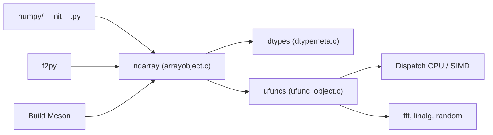

# numpy/numpy

> Python scientific computing library centered on the N-dimensional array, the foundation of the data ecosystem.

## The problem
Python lists are slow and poorly suited to numerical computation on large volumes, with no vectorized operations or built-in linear algebra.

## What it actually does
Provides the ndarray object, broadcasting functions, linear algebra, FFT, random numbers and tools to integrate C, C++ and Fortran. According to the code: calls go through ufuncs, which choose loops by dtype, with runtime CPU dispatch (SIMD). F2PY generates Fortran bindings and the build relies on Meson.

## How it is wired


## Trying it
```bash
python -c "import numpy, sys; sys.exit(numpy.test() is False)"
```
The README shows no installation command.

## Cost and gotchas
Free. Tests require pytest, and optionally Meson, Cython and Hypothesis. External BLAS/LAPACK: a notable build and runtime dependency. License not identified by GitHub.

## What it is not
Not a dataframe or machine learning library: you need pandas, scikit-learn or PyTorch on top. No native GPU computing in the README.

## Alternatives
No alternative cited in the README.

## For you
Adopt, obviously: it is the foundation of almost all Python data/AI tooling, with a large community and active maintenance.
