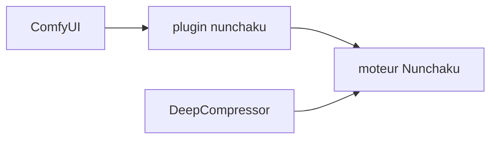

# nunchaku-ai/ComfyUI-nunchaku

> ComfyUI plugin for the Nunchaku engine, which runs 4-bit SVDQuant quantized models.

## The problem
Running heavy image models on a modest GPU requires quantization.

## What it actually does
The README is minimal: it is the ComfyUI plugin for Nunchaku, a 4-bit SVDQuant inference engine. It points to guides (installation, tutorial, workflows, nodes, API). Nothing else is documented here.

## How it is wired

## Trying it
No command documented in the README provided.

## Cost and gotchas
Not documented in the README. A GPU is expected for inference, but the text does not specify it.

## What it is not
Not a standalone tool: it needs ComfyUI and the Nunchaku engine. To quantize a model, it points to DeepCompressor.

## Alternatives
- DeepCompressor: the quantization library cited.

## For you
Worth watching if you do image generation on a limited GPU; README too thin to conclude more.
