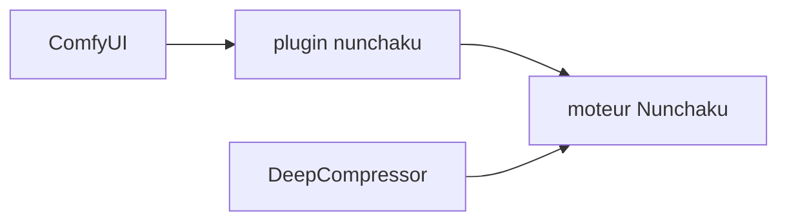

# nunchaku-ai/ComfyUI-nunchaku

> Plugin ComfyUI pour le moteur Nunchaku, qui exécute des modèles quantifiés 4 bits SVDQuant.

## Le problème
Faire tourner des modèles d'image lourds sur un GPU modeste demande de la quantification.

## Ce que ça fait vraiment
Le README est minimal : c'est le plugin ComfyUI de Nunchaku, moteur d'inférence 4 bits SVDQuant. Il renvoie vers des guides (installation, tutoriel, workflows, nœuds, API). Rien d'autre n'est documenté ici.

## Comment c'est branché

## Essayer
Aucune commande documentée dans le README fourni.

## Coût et pièges
Non documenté dans le README. Un GPU est attendu pour l'inférence, mais le texte ne le précise pas.

## Ce que ce n'est pas
Pas un outil autonome : il faut ComfyUI et le moteur Nunchaku. Pour quantifier un modèle, il renvoie vers DeepCompressor.

## Alternatives
- DeepCompressor : bibliothèque de quantification citée.

## Pour toi
À surveiller si tu fais de la génération d'images sur GPU limité ; README trop mince pour trancher plus.

