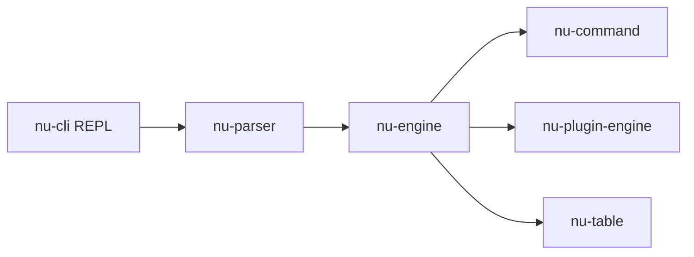

# nushell/nushell

> Shell written in Rust that treats command output as structured data tables.

## The problem
Classic shells handle raw text: filtering or joining results takes awk, grep and a lot of tinkering.

## What it actually does
Each command produces structured values (tables, records) passed through pipelines (`ls | where type == "dir"`). `open` loads TOML, JSON and other formats as data. Plugins: `nu_plugin_*` binaries talking over JSON-RPC on stdin/stdout. Cross-platform.

## How it is wired


## Trying it
```bash
brew install nushell
winget install nushell
```
```shell
ls | where type == "dir" | table
open Cargo.toml | get package.version
```

## Cost and gotchas
Free. The README admits the project is still at the "minimum viable product" level and that the design may change.

## What it is not
Not compatible with Bash syntax: existing scripts do not run as-is.

## Alternatives
No alternative named in the README (PowerShell is cited as an inspiration).

## For you
Watch: pleasant for exploring structured files on the command line; announced instability, do not put it in critical pipelines.
