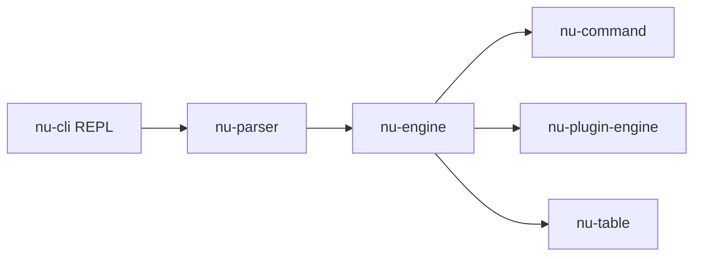

# nushell/nushell

> Shell en Rust qui traite les sorties de commandes comme des tables de données structurées.

## Le problème
Les shells classiques manipulent du texte brut : filtrer ou joindre des résultats demande awk, grep et beaucoup de bricolage.

## Ce que ça fait vraiment
Chaque commande produit des valeurs structurées (tables, enregistrements) passées dans des pipelines (`ls | where type == "dir"`). `open` charge TOML, JSON et autres formats comme données. Plugins : binaires `nu_plugin_*` dialoguant par JSON-RPC sur stdin/stdout. Multiplateforme.

## Comment c'est branché


## Essayer
```bash
brew install nushell
winget install nushell
```
```shell
ls | where type == "dir" | table
open Cargo.toml | get package.version
```

## Coût et pièges
Gratuit. Le README admet que le projet reste au niveau « produit minimal viable » et que le design peut changer.

## Ce que ce n'est pas
Pas compatible avec la syntaxe Bash : les scripts existants ne tournent pas tels quels.

## Alternatives
Aucune alternative nommée dans le README (PowerShell cité comme inspiration).

## Pour toi
Surveiller : agréable pour explorer des fichiers structurés en ligne de commande ; instabilité annoncée, ne pas le mettre dans des pipelines critiques.

