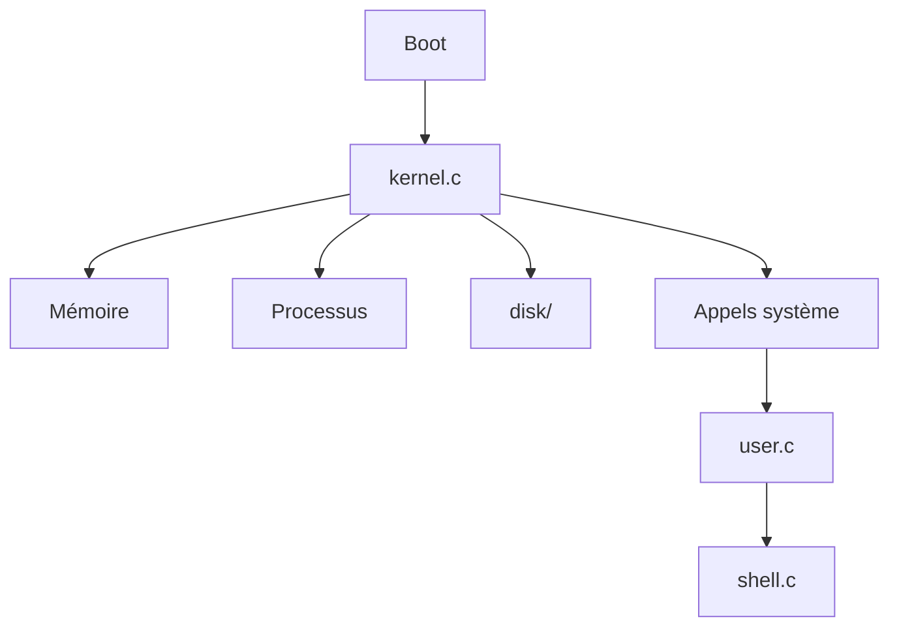

# nuta/operating-system-in-1000-lines

> Online book and reference implementation of a small operating system in about a thousand lines, for low-level enthusiasts.

## The problem
Operating systems seem out of reach until you have seen a complete, minimal kernel.

## What it actually does
- The repository contains the book's website and a reference implementation.
- The README lists reader variants (shutdown, file creation).
- Based on the architecture: kernel, memory, processes, system call, VirtIO, file system, and a shell.
- Targets RISC-V and a VirtIO block driver (based on the diagram).

## How it is wired
Simplified diagram based on the sheet, no diagram provided.

## Trying it
No command documented in the README: it points to the book's website.

## Cost and gotchas
Free. The build and emulation tools are not listed in the README. A license is present but not identified by GitHub.

## What it is not
Not a system usable in production: a teaching resource. The README is under 800 characters.

## Alternatives
No alternative named in the README.

## For you
Ignore for your line of work: it teaches systems, not data or AI.
