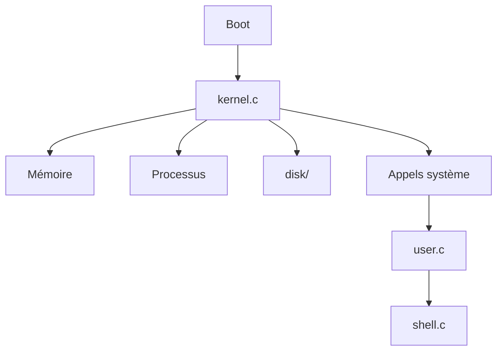

# nuta/operating-system-in-1000-lines

> Livre en ligne et implémentation de référence d'un petit système d'exploitation en environ mille lignes, pour curieux de bas niveau.

## Le problème
Les systèmes d'exploitation semblent inaccessibles tant qu'on n'a pas vu un noyau complet et minimal.

## Ce que ça fait vraiment
- Le dépôt contient le site du livre et une implémentation de référence.
- Le README liste des variantes de lecteurs (arrêt, création de fichiers).
- D'après l'architecture : noyau, mémoire, processus, appel système, VirtIO, système de fichiers, et un shell.
- Cible RISC-V et pilote bloc VirtIO (d'après le diagramme).

## Comment c'est branché
Schéma simplifié d'après la fiche, sans diagramme fourni.

## Essayer
Aucune commande documentée dans le README : il renvoie au site du livre.

## Coût et pièges
Gratuit. Les outils de compilation et d'émulation ne sont pas listés dans le README. Licence présente mais non identifiée par GitHub.

## Ce que ce n'est pas
Pas un système utilisable en production : un support pédagogique. Le README fait moins de 800 caractères.

## Alternatives
Aucune alternative nommée dans le README.

## Pour toi
À ignorer pour ton métier : il enseigne les systèmes, pas la donnée ni l'IA.

