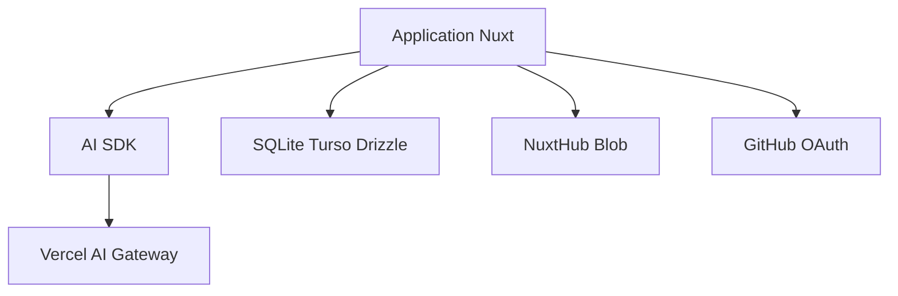

# nuxt-ui-templates/chat

> Nuxt AI chatbot application template, with authentication, history and streaming, for web developers.

## The problem
Putting together a complete AI chat (streaming, history, authentication, upload) takes a lot of assembly.

## What it actually does
A Nuxt UI template wired to the Vercel AI SDK and Vercel AI Gateway: Claude, Gemini and GPT, web search, voice dictation over WebSocket, charts and weather via tool calling. GitHub OAuth login, history in SQLite (Turso in production) with Drizzle, files via NuxtHub Blob.

## How it is wired
Simplified diagram based on the sheet, no diagram provided.



## Trying it
```bash
npm create nuxt@latest -- -t ui/chat
pnpm install
pnpm db:migrate
pnpm dev
```

## Cost and gotchas
`AI_GATEWAY_API_KEY` for local development; model calls are billed. GitHub authentication, Turso and Blob must be configured for production. Uploading files requires being logged in.

## What it is not
Not an agent framework nor a finished product: it is a template to adapt. It depends on Vercel AI Gateway.

## Alternatives
- chat-vue: the Vue version of the same template, cited in the README.

## For you
Worth watching: a good starting point for a chat demo if you know Nuxt; otherwise of little use for pure data work.
