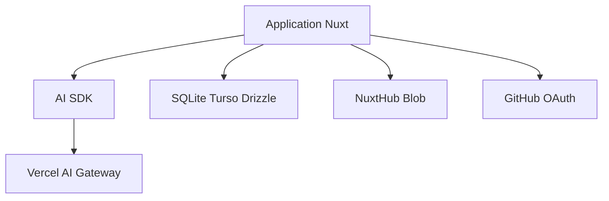

# nuxt-ui-templates/chat

> Modèle d'application de chatbot IA en Nuxt, avec authentification, historique et streaming, pour développeurs web.

## Le problème
Monter un chat IA complet (streaming, historique, authentification, téléversement) demande beaucoup d'assemblage.

## Ce que ça fait vraiment
Un gabarit Nuxt UI branché sur le SDK AI de Vercel et sur Vercel AI Gateway : Claude, Gemini et GPT, recherche web, dictée par WebSocket, graphiques et météo via appel d'outils. Connexion GitHub OAuth, historique en SQLite (Turso en production) avec Drizzle, fichiers via NuxtHub Blob.

## Comment c'est branché
Schéma simplifié d'après la fiche, sans diagramme fourni.



## Essayer
```bash
npm create nuxt@latest -- -t ui/chat
pnpm install
pnpm db:migrate
pnpm dev
```

## Coût et pièges
`AI_GATEWAY_API_KEY` pour le développement local ; les appels aux modèles sont facturés. Authentification GitHub, Turso et Blob à configurer pour la production. L'envoi de fichiers exige d'être connecté.

## Ce que ce n'est pas
Pas un framework d'agents ni un produit fini : c'est un gabarit à adapter. Il dépend de Vercel AI Gateway.

## Alternatives
- chat-vue : la version du même modèle pour Vue, citée dans le README.

## Pour toi
À surveiller : bon point de départ pour une démo de chat si tu connais Nuxt ; sinon peu utile pour un travail data pur.

