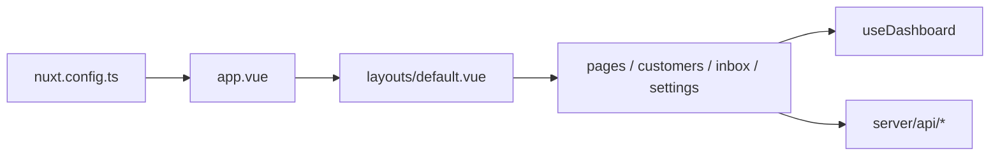

# nuxt-ui-templates/dashboard

> Nuxt UI dashboard template: multiple pages, sidebar, command palette, light/dark themes.

## The problem
Starting a web back-office means rebuilding navigation, tables, charts and themes every time.

## What it actually does
Nuxt template with a home page (stats, client/server chart via `useDashboard`), customers, inbox, settings and members. `server/api/` routes (customers, mails, members, notifications) serve demo data. No database, authentication or third-party service in the tree.

## How it is wired


## Trying it
```bash
npm create nuxt@latest -- -t ui/dashboard
pnpm install
pnpm dev
pnpm build
pnpm preview
```

## Cost and gotchas
Free. The data is fictional: plugging in your own API and authentication is up to you.

## What it is not
Not a BI tool nor a dashboard on real data. A Vue version exists in another repo.

## Alternatives
- nuxt-ui-templates/dashboard-vue: Vue version cited in the README.

## For you
Worth watching: a clean starting point for an interface around a model or a pipeline, with no data value in itself.
