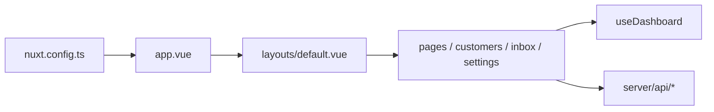

# nuxt-ui-templates/dashboard

> Modèle de tableau de bord Nuxt UI : pages multiples, barre latérale, palette de commandes, thèmes clair/sombre.

## Le problème
Démarrer un back-office web demande de recréer navigation, tables, graphiques et thèmes à chaque fois.

## Ce que ça fait vraiment
Gabarit Nuxt avec accueil (stats, graphique client/serveur via `useDashboard`), clients, boîte de réception, réglages et membres. Des routes `server/api/` (customers, mails, members, notifications) servent des données de démonstration. Aucune base, authentification ni service tiers dans l'arbre.

## Comment c'est branché


## Essayer
```bash
npm create nuxt@latest -- -t ui/dashboard
pnpm install
pnpm dev
pnpm build
pnpm preview
```

## Coût et pièges
Gratuit. Les données sont fictives : brancher ta propre API et l'authentification est à ta charge.

## Ce que ce n'est pas
Pas un outil de BI ni un tableau de bord sur données réelles. Une version Vue existe dans un autre dépôt.

## Alternatives
- nuxt-ui-templates/dashboard-vue : version Vue citée dans le README.

## Pour toi
À surveiller : un point de départ propre pour une interface autour d'un modèle ou d'un pipeline, sans valeur data en soi.

