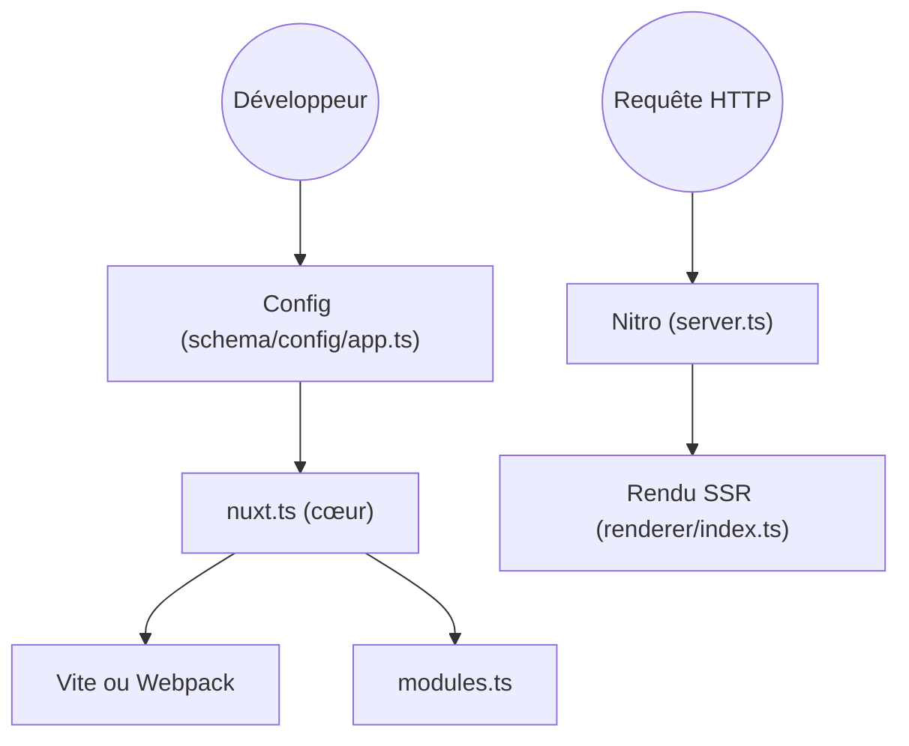

# nuxt/nuxt

> Full-stack framework based on Vue.js for server-rendered or static websites and web applications.

## The problem
Assembling routing, server rendering, SEO and build around Vue requires a lot of manual configuration.

## What it actually does
Generates routes, auto-imports and types from the project structure. Chooses Vite or Webpack for the build and Nitro for the server. Offers server, static, hybrid and edge rendering, a `server/` folder for endpoints and more than 300 extension modules.

## How it is wired


## Trying it
```bash
npm create nuxt@latest <my-project>
```

## Cost and gotchas
Free. Requires Node, and an understanding of Vue. The choice of hosting determines the rendering mode.

## What it is not
Not a data tool nor a ready-made dashboard tool. Not independent of Vue.

## Alternatives
No alternative named in the README.

## For you
Ignore: Vue web framework unrelated to your field, except for an internal interface to build.
