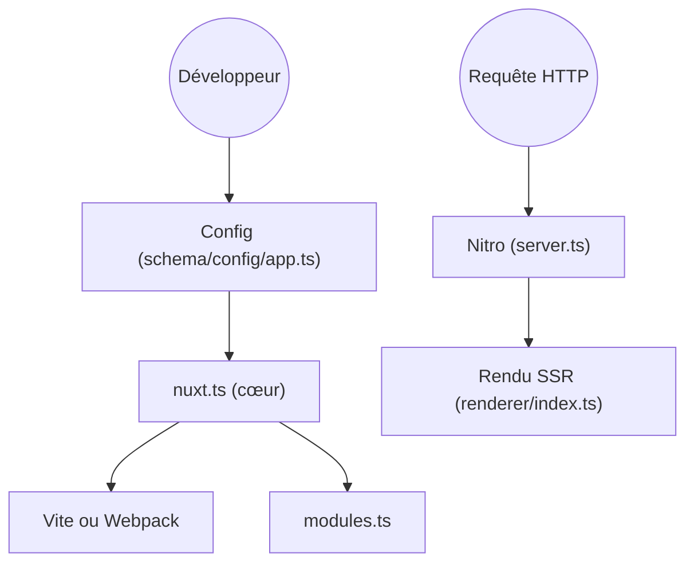

# nuxt/nuxt

> Framework full-stack basé sur Vue.js pour sites et applications web rendus côté serveur ou statiques.

## Le problème
Assembler routage, rendu serveur, SEO et build autour de Vue demande beaucoup de configuration manuelle.

## Ce que ça fait vraiment
Génère routes, imports automatiques et types à partir de la structure du projet. Choisit Vite ou Webpack pour le build et Nitro pour le serveur. Propose rendu serveur, statique, hybride et en périphérie, un dossier `server/` pour les endpoints et plus de 300 modules d'extension.

## Comment c'est branché


## Essayer
```bash
npm create nuxt@latest <my-project>
```

## Coût et pièges
Gratuit. Il faut Node, et la compréhension de Vue. Le choix d'hébergement conditionne le mode de rendu.

## Ce que ce n'est pas
Pas un outil de données ni de tableaux de bord prêt à l'emploi. Pas indépendant de Vue.

## Alternatives
Aucune alternative nommée dans le README.

## Pour toi
À ignorer : framework web Vue sans lien avec ton métier, sauf pour une interface interne à construire.

