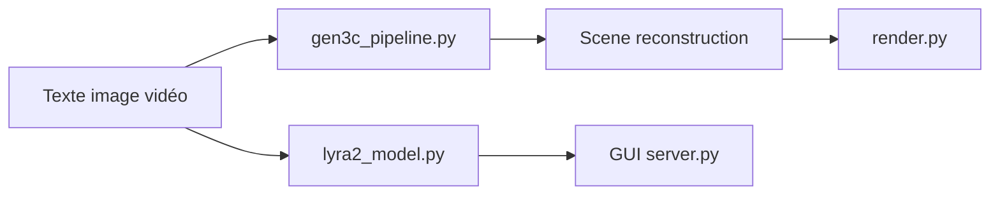

# nv-tlabs/lyra

> Official NVIDIA implementations of Lyra 1.0 and 2.0, generative 3D world models, for researchers.

## The problem
Generating explorable 3D scenes from text, image or video requires linking video generation and reconstruction.

## What it actually does
The README is almost empty: a table pointing to arXiv papers, project pages, Hugging Face weights and the `Lyra-1/` and `Lyra-2/` folders. Based on the code architecture: Lyra 1 combines diffusion, autoregressive video generation and feed-forward reconstruction; Lyra 2 adds long worlds and a client/server graphical interface. Training and video tokenizer included. Usage instructions are not documented here.

## How it is wired

## Trying it
No command documented in the README; see the READMEs of `Lyra-1/` and `Lyra-2/` (not read).

## Cost and gotchas
A heavy NVIDIA GPU is likely, not specified. Weights to download from Hugging Face.

## What it is not
Not a turnkey product: a research base whose instructions live elsewhere.

## Alternatives
No alternative named in the README.

## For you
Worth watching: interesting for following research on generative 3D worlds, but installation cannot be judged without reading the subfolders; Apache-2.0 and a solid publisher.
