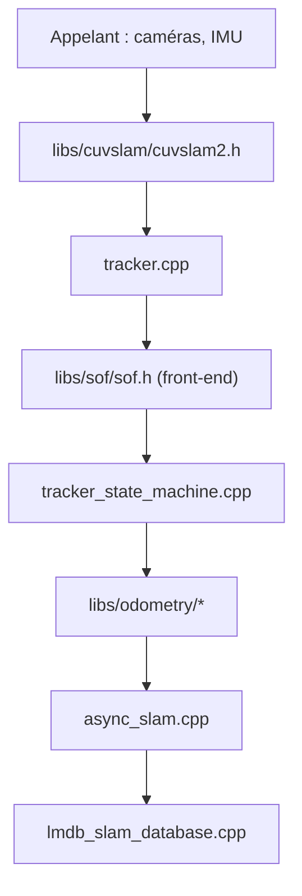

# nvidia-isaac/cuVSLAM

> NVIDIA library for CUDA-accelerated visual odometry and SLAM, for cameras, IMUs and robots.

## The problem
A robot must localize itself and map in real time from cameras, without manual tuning.

## What it actually does
Five odometry modes: Mono, RGBD, Multicamera, Inertial, Multisensor (the latter experimental). Asynchronous SLAM closes loops, saves maps in LMDB and can relocalize, including without a starting pose via AnyLoc (DINOv2, TensorRT). C++ and Python interfaces.

## How it is wired


## Trying it
```bash
pip install cuvslam_cu12-*.whl
pip install "./cuvslam_cu12-<version>-<tags>.whl[cuda]"
cmake -S . -B build
cmake --build build --parallel $(nproc)
```

## Cost and gotchas
Free, but requires an NVIDIA GPU, CUDA 12 or 13 and Ubuntu 22.04+ (or Jetson). The wheels only cover specific combinations. License not identified by GitHub. Camera calibration and 1 ms synchronization are decisive.

## What it is not
Not a turnkey piece of software: no tuning is expected, but calibrated cameras are needed. The Multisensor mode remains experimental.

## Alternatives
No alternative named in the README.

## For you
Worth watching: interesting if you do vision or robotics on NVIDIA GPUs, but the license needs checking and the field is narrow.
