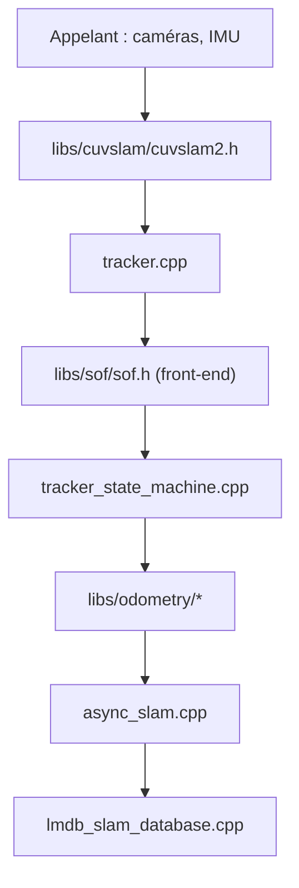

# nvidia-isaac/cuVSLAM

> Bibliothèque NVIDIA d'odométrie visuelle et de SLAM accélérés par CUDA, pour caméras, IMU et robots.

## Le problème
Un robot doit se localiser et cartographier en temps réel à partir de caméras, sans réglages à la main.

## Ce que ça fait vraiment
Cinq modes d'odométrie : Mono, RGBD, Multicamera, Inertial, Multisensor (ce dernier expérimental). Le SLAM asynchrone ferme les boucles, enregistre les cartes dans LMDB et peut se relocaliser, y compris sans pose de départ via AnyLoc (DINOv2, TensorRT). Interfaces C++ et Python.

## Comment c'est branché


## Essayer
```bash
pip install cuvslam_cu12-*.whl
pip install "./cuvslam_cu12-<version>-<tags>.whl[cuda]"
cmake -S . -B build
cmake --build build --parallel $(nproc)
```

## Coût et pièges
Gratuit, mais exige un GPU NVIDIA, CUDA 12 ou 13 et Ubuntu 22.04+ (ou Jetson). Les roues ne couvrent que des combinaisons précises. Licence non identifiée par GitHub. Calibration et synchronisation des caméras à 1 ms sont déterminantes.

## Ce que ce n'est pas
Pas un logiciel clés en main : aucun réglage n'est attendu, mais il faut des caméras calibrées. Le mode Multisensor reste expérimental.

## Alternatives
Aucune alternative nommée dans le README.

## Pour toi
À surveiller : intéressant si tu fais de la vision ou de la robotique sur GPU NVIDIA, mais la licence est à vérifier et le champ est étroit.

