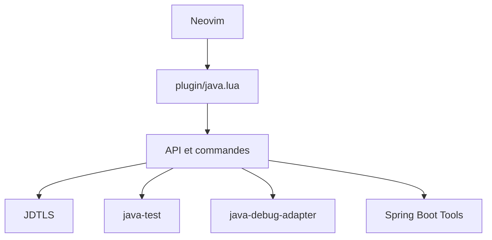

# nvim-java/nvim-java

> Neovim plugin that installs and configures the whole Java toolchain (LSP, tests, debugging, Spring Boot).

## The problem
Setting up jdtls, the debugger and Java tests in Neovim is tedious.

## What it actually does
It installs jdtls, Lombok, java-test, java-debug-adapter, Spring Boot Tools and a JDK, then offers diagnostics, completion, imports, formatting, test execution and debugging, run profiles, a launcher with a log viewer, a decompiler and refactorings.

## How it is wired


## Trying it
```lua
{
  'nvim-java/nvim-java',
  config = function()
    require('java').setup()
    vim.lsp.enable('jdtls')
  end,
}
```

## Cost and gotchas
Free. Neovim 0.11.5 or later. Tools are downloaded automatically (JDK 17 by default); this can be disabled with `auto_install = false`. Java is not in the list of possible prerequisites: a JDK is the real need.

## What it is not
It is not a full IDE: it is a configuration layer on top of Neovim's LSP client.

## Alternatives
The README points out a conflict with nvim-jdtls (checked at startup).

## For you
Ignore: you mostly write Python; only useful if you do Java in Neovim.
