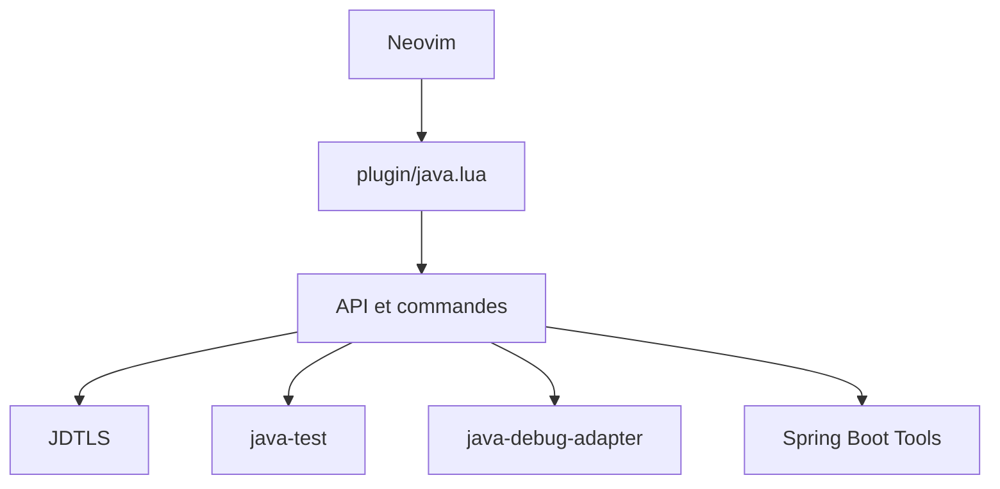

# nvim-java/nvim-java

> Plugin Neovim qui installe et configure tout l'outillage Java (LSP, tests, débogage, Spring Boot).

## Le problème
Configurer jdtls, le débogueur et les tests Java dans Neovim est fastidieux.

## Ce que ça fait vraiment
Il installe jdtls, Lombok, java-test, java-debug-adapter, Spring Boot Tools et un JDK, puis offre diagnostics, complétion, imports, formatage, exécution et débogage de tests, profils d'exécution, lanceur avec visionneuse de logs, décompilateur et refactorisations.

## Comment c'est branché


## Essayer
```lua
{
  'nvim-java/nvim-java',
  config = function()
    require('java').setup()
    vim.lsp.enable('jdtls')
  end,
}
```

## Coût et pièges
Gratuit. Neovim 0.11.5 ou plus. Téléchargements automatiques d'outils (JDK 17 par défaut), désactivables par `auto_install = false`. Java n'est pas dans la liste de prérequis possibles : un JDK est le besoin réel.

## Ce que ce n'est pas
Ce n'est pas un IDE complet : c'est une couche de configuration sur le client LSP de Neovim.

## Alternatives
Le README signale un conflit avec nvim-jdtls (vérification au démarrage).

## Pour toi
À ignorer : tu écris surtout du Python ; utile seulement si tu fais du Java sous Neovim.

