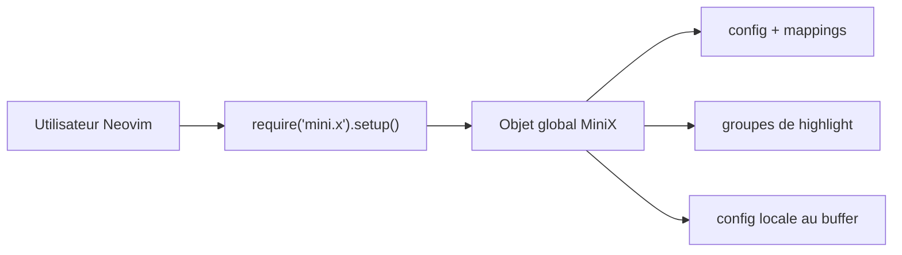

# nvim-mini/mini.nvim

> A collection of more than 45 independent Lua modules that extend Neovim, for anyone configuring their editor.

## The problem
Bare Neovim means stacking dozens of plugins with different conventions. Each one is configured in its own way.

## What it actually does
Provides separate modules: editing (ai, surround, pairs, comment), workflow (files, pick, clue, git, diff), appearance (statusline, icons, hues) and miscellaneous (doc, test). Each module is enabled by its own `setup()`, creates a global `MiniXxx` object and remains usable without the others. No language-specific functionality: a deliberate choice.

## How it is wired


## Trying it
```bash
# Neovim 0.12+, dans init.lua :
vim.pack.add({ 'https://github.com/nvim-mini/mini.nvim' })
# lazy.nvim :
{ 'nvim-mini/mini.nvim', version = false },
```

## Cost and gotchas
Free. Neovim 0.10 minimum; each module must call `setup()` or nothing is enabled. On Windows, paths may be too long at installation.

## What it is not
Not a ready-to-use Neovim distribution (MiniMax is an example config). No per-language support. The "planned" modules listed do not exist yet.

## Alternatives
- folke/lazy.nvim: a plugin manager, which mini.nvim does not force you to use (mini.deps exists too).

## For you
Adopt if you spend time in Neovim: a single coherent repository replaces about ten plugins, with an active maintainer.
